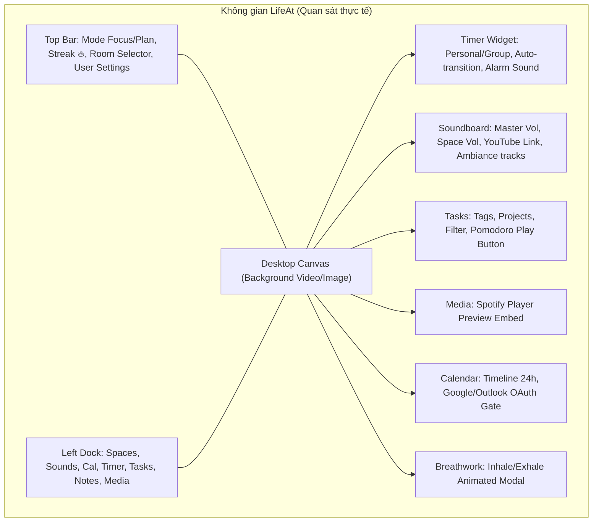
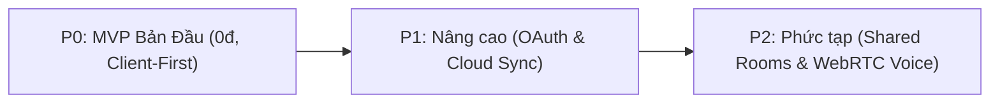

# 00 — EXECUTIVE SUMMARY (TÓM TẮT ĐIỀU HÀNH)

> **Dự án:** Immersive Pomodoro Workspace (Lấy cảm hứng từ LifeAt.io)  
> **Giai đoạn:** Nghiên cứu & Thiết kế Đặc tả Kỹ thuật (Research & Product Spec)  
> **Trạng thái:** Bản hoàn chỉnh chuẩn bị trình duyệt trước khi chuyển sang giai đoạn Coding  
> **Nguyên tắc vận hành:** Chi phí 0 đồng (Zero-cost), Kiến trúc Ưu tiên Phía Client (Client-First / Offline-First), Không xâm phạm bản quyền thương mại.

---

## 1. Tầm nhìn & Mục tiêu Sản phẩm

### 1.1. Bối cảnh thị trường & Vấn đề hiện tại
- Các ứng dụng Pomodoro truyền thống thường đơn điệu, chỉ có đồng hồ đếm ngược và vài danh sách việc cần làm tẻ nhạt, thiếu khả năng kích thích giác quan và tạo cảm hứng thị giác.
- Nền tảng tham chiếu **LifeAt.io** `[OBSERVED]` đã chứng minh thành công của mô hình **Không gian ảo đắm chìm (Virtual Immersive Spaces)**: biến màn hình làm việc thành một góc học tập có cửa sổ ngắm mưa, quán cà phê lofi, cảnh núi hồ thiên nhiên, kết hợp âm thanh môi trường và hệ thống cửa sổ widget nổi kiểu desktop.
- Tuy nhiên, qua khảo sát thực tế tại `evidence/05-notes-pro-gate.png` `[OBSERVED]`, LifeAt áp dụng chính sách thương mại hóa khắt khe: khóa widget Notes, Daily Planner, Lịch nâng cao và nhiều không gian nền phía sau gói trả phí Pro **$8/tháng**.

### 1.2. Định vị Sản phẩm của Chúng ta
- Xây dựng một **Web Immersive Pomodoro Workspace** hoạt động trực tiếp trên trình duyệt, kế thừa trải nghiệm thị giác và tương tác đỉnh cao của LifeAt nhưng được thiết kế độc lập `[USER_REQUIREMENT]`.
- **Triết lý sản phẩm:**
  1. **Không rào cản (Frictionless):** Người dùng mở web lên là có thể sử dụng ngay lập tức mà không bắt buộc phải tạo tài khoản hay thanh toán phí duy trì `[USER_REQUIREMENT]`.
  2. **Quyền riêng tư & Lưu trữ cục bộ (Local-First):** Toàn bộ dữ liệu công việc (Tasks), ghi chú (Notes), thói quen và cấu hình giao diện được lưu trữ bền vững tại trình duyệt thông qua `IndexedDB` và `LocalStorage` `[INFERRED]`.
  3. **Trải nghiệm Desktop thu nhỏ (Desktop-like Window Manager):** Các widget (Timer, Tasks, Notes, Sounds, Media) hoạt động như các cửa sổ độc lập: có thể kéo thả tự do, thay đổi kích thước, thu nhỏ xuống thanh Dock, lưu nhớ tọa độ và hỗ trợ responsive thông minh cho điện thoại/tablet `[USER_REQUIREMENT]`.
  4. **Vận hành 0 đồng (Zero-cost Operations):** Kiến trúc ban đầu hoàn toàn không đòi hỏi server đắt tiền; chuông báo được tổng hợp bằng Web Audio API nội tại; âm thanh môi trường dùng loop nén tối ưu mã nguồn mở `[INFERRED]`.

---

## 2. Kết quả Khảo sát Thực nghiệm (Evidence Insights)

Dựa trên 8 ảnh chụp màn hình thu thập trực tiếp từ hệ thống LifeAt (`product-spec/evidence/`), nhóm nghiên cứu ghi nhận các điểm then chốt:

- **Hệ thống Timer (`03-timer-settings.png`) `[OBSERVED]`:** Hỗ trợ 3 pha chuẩn (Pomodoro, Short Break, Long Break), tự động chuyển pha (Auto-transition), ẩn số chu kỳ (Hide count), hỗ trợ các âm chuông phong phú như Twinkle, Playtime, Sci-fi, Slow Rise, Rooster, Bird và thanh chỉnh âm lượng riêng.
- **Mixer âm thanh đa tầng (`02-soundboard.png`) `[OBSERVED]`:** Cho phép tinh chỉnh đồng thời: Âm lượng tổng (Master Volume), Âm thanh nền video (Spaces Audio), Nhạc nhúng từ link YouTube (`Youtube Link`), và các âm thanh thiên nhiên/sóng não (`Ambiance`).
- **Cơ chế Paywall (`05-notes-pro-gate.png`) `[OBSERVED]`:** Người dùng Free bị chặn khi bấm vào Notes hoặc các tính năng lập kế hoạch nâng cao. Dự án của chúng ta sẽ cung cấp miễn phí tính năng Notes độc lập và gắn liền với Task `[USER_REQUIREMENT]`.
- **Tính năng Thư giãn Thở (`08-pro-space-modal.png`) `[OBSERVED]`:** LifeAt tích hợp modal hướng dẫn hít thở (Breathwork: Inhale - Hold - Exhale) hỗ trợ giải tỏa căng thẳng trong các khoảng nghỉ Pomodoro.

---

## 3. Chiến lược Phân tầng Tính năng (Phasing Strategy)

Để đảm bảo dự án có thể hoàn thành nhanh, chạy mượt mà và không phát sinh chi phí hạ tầng, các yêu cầu của chủ dự án được phân bổ làm 3 giai đoạn:

### Giai đoạn P0 — MVP cốt lõi (Mục tiêu phát hành đầu tiên, Ngân sách 0 đồng)
- **Desktop Workspace Shell:** Khung nền toàn màn hình, hỗ trợ đổi background (ảnh tĩnh HD, video WebM/MP4 lặp nhẹ, và dán URL tùy chỉnh).
- **Window Management:** Kéo thả (Drag), đổi kích thước (Resize), thu nhỏ (Minimize), khôi phục từ thanh Dock bên trái, xếp lớp z-index, lưu tọa độ vào LocalStorage.
- **Pomodoro Personal Timer:** Đếm lùi Focus (mặc định 25 hoặc 40 phút), Short Break (5 phút), Long Break (15 phút); đếm vòng lặp; auto-transition; chuông báo tổng hợp Web Audio API (không sợ chết link mp3).
- **Thuật toán Timer chạy ngầm chuẩn xác:** Chạy trên sai số timestamp mục tiêu (`Date.now()`) kết hợp Web Worker / Web Audio clock để không bị trình duyệt làm trễ khi ẩn tab.
- **Ambient Sound Mixer:** Bảng trộn âm thanh đa lớp (Mưa, Sấm, Sóng biển, Rừng cây, Quán cafe, Bàn phím cơ, Lửa trại, Tiếng mèo purr, Sóng não Alpha/Delta...) có slider riêng từng track và Master volume.
- **Task & Notes Widget:** CRUD công việc, lọc theo Tags/Projects, gắn nút đếm Pomodoro cho từng task; khung ghi chú hỗ trợ Markdown, lưu vĩnh viễn trên IndexedDB của trình duyệt.
- **Media YouTube Player:** Nhúng player video YouTube an toàn qua IFrame Player API.
- **Breathwork Modal:** Bài tập thở 4-4-4-4 (Box breathing) hỗ trợ hồi phục tâm trí.
- **Mobile Responsive Fallback:** Tự động chuyển đổi layout sang dạng Bottom Sheet / Tab View khi mở trên màn hình nhỏ điện thoại.

### Giai đoạn P1 — Bản mở rộng sau MVP (Post-MVP Enhancements)
- **Tích hợp Google Calendar (Chế độ Đọc):** Đăng nhập OAuth 2.0 PKCE phía client để kéo lịch trong ngày hiển thị lên timeline widget mà không cần server backend.
- **Task Countdown Timer Mode:** Bộ đếm thời gian chuyên dụng chạy đếm lùi cho một đầu việc cụ thể với hạn chót (Deadline countdown).
- **Background Studio Mở rộng:** Bộ sưu tập preset theo tâm trạng (Rainy Mood, Cafe Vibes, Deep Space, Lo-Fi Cozy Room).
- **Cloud Backup & Đồng bộ hóa tùy chọn:** Cho phép người dùng đăng nhập qua tài khoản Google/Email (sử dụng gói miễn phí Supabase/Firebase) để đồng bộ danh sách task và cài đặt giữa các máy tính.
- **Spotify Embed Widget:** Tích hợp trình phát nhạc Spotify preview qua chuẩn IFrame.

### Giai đoạn P2 — Tính năng phức tạp (Cần đánh giá rủi ro, bảo mật và chi phí)
- **Phòng học chung ảo (Shared Co-working Rooms):** Đồng bộ trạng thái đếm giờ Pomodoro của nhóm, danh sách thành viên trong phòng, bảng trạng thái focus. Yêu cầu máy chủ WebSocket/Realtime.
- **Voice Chat & Micro:** Đàm thoại nhóm thời gian thực qua WebRTC. Đòi hỏi cấu hình STUN/TURN server (có nguy cơ phát sinh chi phí băng thông nếu lưu lượng lớn), cơ chế cấp quyền microphone, lọc ồn và phòng chống spam/quấy rối.
- **Đồng bộ Lịch 2 chiều (2-way Calendar Sync):** Tạo và sửa sự kiện từ widget đẩy ngược về Google Calendar.

---

## 4. Tóm tắt Đánh giá Rủi ro Kỹ thuật & Quyết định Then chốt

| Hạng mục kỹ thuật | Rủi ro tiềm ẩn | Quyết định kỹ thuật áp dụng |
| :--- | :--- | :--- |
| **Timer bị chậm khi chuyển tab** | Trình duyệt hiện đại (Chrome/Edge/Safari) tự động bóp nghẹt (throttle) `setInterval` xuống 1 lần/phút khi tab không active `[INFERRED]`. | Bắt buộc sử dụng cơ chế **Delta Timestamp** (`targetEndTime = Date.now() + remainingMs`) kết hợp **Web Worker** độc lập chạy ngoài UI thread `[USER_REQUIREMENT]`. |
| **Âm thanh bị chặn (Autoplay Policy)** | Trình duyệt chặn phát âm thanh nếu người dùng chưa tương tác (chạm/click) vào trang web `[INFERRED]`. | Khởi tạo `AudioContext` ở trạng thái `suspended`, chỉ kích hoạt `audioContext.resume()` ngay sau click đầu tiên của người dùng lên nút Play/Start `[INFERRED]`. |
| **Âm chuông phụ thuộc file mạng** | Tải file âm thanh `.wav`/`.mp3` chuông từ server ngoài dễ bị lỗi mạng hoặc 404 `[INFERRED]`. | Lập trình các âm chuông (Twinkle, Sci-fi, Bird chiptune...) bằng sóng âm tổng hợp nội suy ngay trên máy khách (`OscillatorNode` + `GainEnvelope`) `[USER_REQUIREMENT]`. |
| **Tích hợp Nhạc bản quyền** | Spotify và Apple Music không cho phép phát toàn bài tự do nếu không có tài khoản Premium và API cấp phép thương mại `[INFERRED]`. | Sử dụng **YouTube IFrame Embed** làm giải pháp phát nhạc chính; Spotify chỉ hỗ trợ ở dạng embed preview 30s `[USER_REQUIREMENT]`. |
| **Chi phí máy chủ $0** | Duy trì backend server có thể tốn chi phí thuê VPS hàng tháng `[INFERRED]`. | Toàn bộ ứng dụng là **Static Web Application (SPA)**, triển khai miễn phí 100% trên Cloudflare Pages, Vercel hoặc GitHub Pages; lưu trữ 100% trên thiết bị người dùng `[USER_REQUIREMENT]`. |

---

## 5. Kết luận & Điều kiện Nghiệm thu (Definition of Ready)

Bản tóm tắt điều hành này khẳng định:
1. Dự án đã có định hướng kiến trúc rõ ràng, bền vững và thực tế, phân tách rạch ròi giữa quan sát thực tế từ LifeAt và yêu cầu tính năng mục tiêu.
2. Bộ 12 tài liệu đặc tả tiếp theo sẽ cung cấp đầy đủ chi tiết cho một Coding Agent triển khai mã nguồn ngay lập tức sau khi nhận được sự đồng thuận của Chủ dự án.
