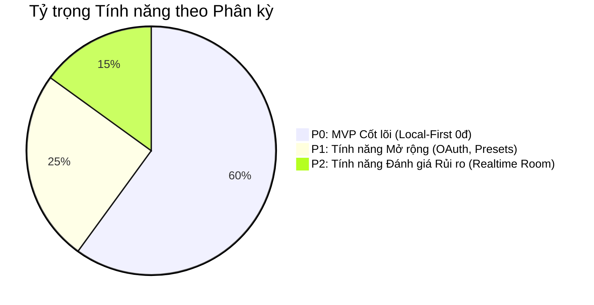

# 01 — PRODUCT REQUIREMENTS DOCUMENT (PRD)

> **Tên sản phẩm:** Immersive Pomodoro Workspace  
> **Phiên bản tài liệu:** 1.0 (Baseline Specification)  
> **Trạng thái:** Chờ phê duyệt (Pending Approval)  
> **Đối tượng áp dụng:** Product Owner, UI/UX Designer, Frontend/Fullstack Coding Agents.

---

## 1. Tổng quan & Mục tiêu Dự án

### 1.1. Mục tiêu sản phẩm (Product Goals)
1. Cung cấp một không gian làm việc trực tuyến đa giác quan (thị giác, thính giác) giúp người dùng duy trì trạng thái tập trung cao độ (Deep Work / Flow State) thông qua kỹ thuật Pomodoro `[USER_REQUIREMENT]`.
2. Tái tạo trải nghiệm không gian làm việc ảo tương tự máy tính để bàn (Desktop-like Virtual Workspace) với hệ thống cửa sổ widget di động linh hoạt `[OBSERVED]`, loại bỏ các rào cản thanh toán hoặc bắt buộc đăng nhập tài khoản `[USER_REQUIREMENT]`.
3. Vận hành ổn định, mượt mà trên nền tảng web với chi phí máy chủ 0 đồng trong giai đoạn MVP, ưu tiên kiến trúc lưu trữ cục bộ (Local-First) và tổng hợp âm thanh bằng Web Audio API `[INFERRED]`.

### 1.2. Chân dung Người dùng (User Personas)
- **Persona 1: Sinh viên / Người tự học (Student Alex, 20 tuổi):** Cần không gian yên tĩnh, thẩm mỹ cao (Lo-fi study with me), bật tiếng mưa và nhạc nền để ôn thi 4-6 tiếng liên tục. Cần danh sách bài tập (Tasks) và đồng hồ đếm ngược từng ca học.
- **Persona 2: Lập trình viên / Kỹ sư phần mềm (Developer Minh, 26 tuổi):** Làm việc từ xa (WFH), thường xuyên bị xao nhãng bởi mạng xã hội. Thích âm thanh bàn phím cơ kết hợp tiếng suối, quản lý công việc theo thẻ dự án (Projects), thích giao diện Dark mode và đồng hồ tự động chuyển hiệp.
- **Persona 3: Nhà văn / Content Creator (Writer Linh, 24 tuổi):** Cần khung ghi chú (Notes) rộng rãi ngay cạnh đồng hồ đếm giờ, thích chuyển đổi các background cảnh thiên nhiên hùng vĩ để tạo cảm hứng sáng tác.

---

## 2. Phân chia Phạm vi Sản phẩm (Product Scope & Phasing)

- **Trong phạm vi MVP (P0):**
  - Desktop-like Canvas & Window Manager (Drag, Resize, Minimize, Z-index, Dock, Persistence LocalStorage) `[USER_REQUIREMENT]`.
  - Background Studio: Ảnh tĩnh HD, Video Loop, Custom URL, Filter làm mờ/chỉnh sáng `[USER_REQUIREMENT]`.
  - Pomodoro Personal Timer: Đếm giờ Focus/Short/Long Break, Auto-transition, Hide count, Chuông Web Audio API (Twinkle, Playtime, Sci-fi, Slow Rise, Rooster, Bird) `[USER_REQUIREMENT]`.
  - Timer Engine chính xác: Chạy trên timestamp hiệu số, không bị throttle khi chuyển tab nền `[USER_REQUIREMENT]`.
  - Ambient Sound Mixer: Trộn đa kênh âm thanh môi trường + Master Volume `[USER_REQUIREMENT]`.
  - Tasks Widget: CRUD, Tags, Projects, Nút gắn timer, Lưu trữ IndexedDB `[USER_REQUIREMENT]`.
  - Notes Widget: Ghi chú độc lập và liên kết task, hỗ trợ Markdown `[USER_REQUIREMENT]`.
  - Media Embed: Trình phát YouTube an toàn qua iframe API `[USER_REQUIREMENT]`.
  - Breathwork Modal: Bài tập thở thư giãn 4-4-4-4 `[OBSERVED]`.
  - Mobile Responsive Fallback `[USER_REQUIREMENT]`.
- **Giai đoạn P1 (Nâng cao sau MVP):**
  - Tích hợp Google Calendar View (Đọc sự kiện qua OAuth 2.0 PKCE) `[USER_REQUIREMENT]`.
  - Task Countdown Timer Mode `[USER_REQUIREMENT]`.
  - Preset không gian làm việc theo chủ đề `[USER_REQUIREMENT]`.
  - Cloud Backup tùy chọn qua Supabase Free Tier `[USER_REQUIREMENT]`.
- **Giai đoạn P2 (Cần đánh giá rủi ro & chi phí hạ tầng):**
  - Phòng học nhóm ảo (Shared Co-working Rooms) có realtime state sync `[USER_REQUIREMENT]`.
  - Voice Chat / Micro tương tác nhóm qua WebRTC + STUN/TURN server `[USER_REQUIREMENT]`.
  - Đồng bộ lịch 2 chiều Google Calendar / Outlook `[USER_REQUIREMENT]`.

---

## 3. Đặc tả Chi tiết Tính năng theo Module (Module Specifications)

### 3.1. Module Workspace Shell & Window Manager
- **Mã định danh:** `MOD-WORKSPACE` | **Ưu tiên:** `P0`
- **Mô tả:** Màn hình nền chiếm 100% diện tích trình duyệt (`100vw`, `100vh`), hiển thị background và chứa các cửa sổ widget nổi kiểu hệ điều hành desktop `[OBSERVED]`.
- **User Stories:**
  - *Là một người dùng, tôi muốn có thể kéo thả widget đến bất kỳ vị trí nào trên màn hình để không che mất phong cảnh yêu thích.*
  - *Là một người dùng, tôi muốn thu nhỏ widget xuống thanh dock và mở lại khi cần để giữ bàn làm việc gọn gàng.*
- **Chi tiết giao diện & hành vi:**
  - **Left Dock (Thanh công cụ cố định bên trái) `[OBSERVED]`:** Chứa các nút kích hoạt mở/tắt widget: Spaces (Nền), Sounds (Âm thanh), Cal (Lịch), Timer (Đồng hồ), Tasks (Công việc), Notes (Ghi chú), Media (Nhạc), Breathwork (Tập thở). Nút đang active sẽ có highlight màu thương hiệu.
  - **Top Navigation Bar `[OBSERVED]`:** Dropdown chuyển Mode (Focus / Plan / Explore), hiển thị chuỗi ngày streak (`3 🔥`), nút mở Fullscreen, nút cài đặt chung.
  - **Cơ chế Cửa sổ (Windowing Rules) `[USER_REQUIREMENT]`:**
    - Mỗi widget có thanh tiêu đề (Header bar) làm vùng cầm nắm để kéo thả (Drag Handle).
    - Nút thu nhỏ (`-`) ở góc phải thanh tiêu đề: ẩn cửa sổ vào Dock.
    - Góc dưới cùng bên phải của mỗi widget có ký hiệu tam giác chấm (Resize Handle) để co giãn kích thước bằng chuột.
    - Click vào bất kỳ vùng nào của widget sẽ nâng `z-index` của widget đó lên cao nhất (mang ra phía trước).
    - Lưu vị trí `(x, y)` và kích thước `(width, height)` vào `LocalStorage`. Khi tải lại trang, khôi phục nguyên trạng.
  - **Mobile / Tablet Fallback `[USER_REQUIREMENT]`:**
    - Khi chiều rộng màn hình `< 768px`, tắt cơ chế cửa sổ tự do.
    - Chuyển dock sang dạng thanh điều hướng dưới đáy (Bottom Navigation Bar).
    - Widget khi mở sẽ hiển thị dạng Bottom Sheet hoặc Modal trượt lên che 85% màn hình, có nút đóng rõ ràng.

### 3.2. Module Background Studio
- **Mã định danh:** `MOD-BG` | **Ưu tiên:** `P0`
- **Mô tả:** Hệ thống quản lý hình ảnh và video làm nền cho toàn bộ không gian làm việc `[USER_REQUIREMENT]`.
- **Dữ liệu thực nghiệm LifeAt (`01-home-app.png`) `[OBSERVED]`:** LifeAt tổ chức Spaces thành các tab `Videos`, `Images`, `Favorites`, có ô tìm kiếm và danh mục icon nhanh: Cảnh thiên nhiên, Quán cà phê, Cửa sổ mưa, Hoa anh đào, Hoạt hình lofi. Có thanh gạt âm lượng không gian (`Spaces Audio`) ở đáy.
- **Yêu cầu triển khai chi tiết `[USER_REQUIREMENT]`:**
  - **Bộ sưu tập mặc định:** Cung cấp sẵn ít nhất 10 hình nền tĩnh độ phân giải 4K (Unsplash nguồn mở) và 6 video nền chuyển động nhẹ nhàng lặp vòng (Looping MP4/WebM tối ưu < 5MB).
  - **Custom Background:** Cho phép người dùng nhập trực tiếp URL ảnh hoặc URL video từ bên ngoài (YouTube hoặc direct link).
  - **Tùy chỉnh thị giác (Visual Controls):** Thanh trượt độ mờ nền (Blur: 0 - 20px) và độ tối nền (Brightness/Dim: 30% - 100%) giúp làm nổi bật các widget làm việc khi nền quá sáng.
  - **Âm thanh nền (Space Audio):** Nếu video nền có tiếng tự nhiên, cung cấp thanh trượt âm lượng độc lập và nút Mute `[OBSERVED]`.

### 3.3. Module Pomodoro Timer
- **Mã định danh:** `MOD-TIMER` | **Ưu tiên:** `P0`
- **Mô tả:** Đồng hồ đếm thời gian năng suất trung tâm của ứng dụng `[USER_REQUIREMENT]`.
- **Dữ liệu thực nghiệm LifeAt (`03-timer-settings.png`) `[OBSERVED]`:**
  - Chế độ hiển thị: Chọn `Personal` (cá nhân) với dropdown.
  - Chỉ báo chu kỳ: 4 chấm tròn biểu thị tiến trình 4 hiệp Pomodoro.
  - Đồng hồ số lớn: Định dạng `MM:SS` (ví dụ `40:00`).
  - Thanh chọn hiệp: `Pomodoro` | `Short Break` | `Long Break`.
  - Nút điều khiển: Nút `Start` (khi chạy đổi thành `Pause`), nút `Reset` (mũi tên vòng tròn quay lại đầu hiệp), nút `⚙` (Cài đặt).
  - Bảng cài đặt:
    - Checkbox `Auto-transition Timer`: Tự động nhảy sang giờ giải lao khi hết giờ làm việc và ngược lại.
    - Checkbox `Hide Pomodoro Count`: Ẩn 4 chấm tròn đếm vòng nếu người dùng cảm thấy áp lực.
    - Các ô nhập số phút: `Pomodoro` (mặc định 25 hoặc 40), `Short Break` (mặc định 5), `Long Break` (mặc định 15).
    - Dropdown `Timer Sound`: Chọn âm báo kết thúc hiệp.
    - Thanh trượt âm lượng chuông báo riêng.
- **Yêu cầu âm thanh chuông báo `[USER_REQUIREMENT]`:**
  - Hỗ trợ đầy đủ các âm sắc: **Twinkle**, **Playtime**, **Sci-fi**, **Slow Rise**, **Rooster**, **Bird**.
  - *Giải pháp kỹ thuật bắt buộc:* Lập trình tổng hợp trực tiếp bằng **Web Audio API** (`OscillatorNode`, `GainNode`, bộ tần số âm nhạc hợp âm) để đảm bảo 100% không phụ thuộc máy chủ, không bị lỗi mạng và độ trễ 0ms `[INFERRED]`.
- **Giải thuật Timer chống trôi lệch (Drift-proof Timer Engine) `[USER_REQUIREMENT]`:**
  - Tuyệt đối không dùng `remainingSeconds--` trong `setInterval` thông thường vì các trình duyệt (Chrome, Safari, Edge) sẽ giảm tần suất chạy của tab nền xuống 1 lần mỗi phút để tiết kiệm pin `[INFERRED]`.
  - *Giải thuật:* Khi nhấn Start, ghi nhận `targetEndTime = Date.now() + durationMs`. Mỗi nhịp hiển thị, tính `remainingMs = Math.max(0, targetEndTime - Date.now())`. Kết hợp Web Worker để gửi tín hiệu `tick` liên tục cả khi tab bị ẩn.
  - Tích hợp thông báo trình duyệt (**Web Notification API**) và hiển thị thời gian đếm lùi trên tiêu đề tab trình duyệt (`document.title = "24:59 | Focus - Pomodoro"`).

### 3.4. Module Ambient Sound Mixer (Bảng trộn Âm thanh Môi trường)
- **Mã định danh:** `MOD-SOUNDS` | **Ưu tiên:** `P0`
- **Mô tả:** Hệ thống giả lập âm thanh không gian đa lớp giúp triệt tiêu tiếng ồn xung quanh và kích thích sóng não tập trung `[USER_REQUIREMENT]`.
- **Dữ liệu thực nghiệm LifeAt (`02-soundboard.png`) `[OBSERVED]`:** Cấu trúc bảng Soundboard gồm: `Master Volume` ở trên cùng, `Spaces Audio` slider, `Youtube Link` slider, và danh mục `Ambiance` từng track âm thanh có nút mute + slider riêng.
- **Danh mục âm thanh yêu cầu `[USER_REQUIREMENT]`:**
  1. *Thiên nhiên:* Rain (mưa rào), Rain on car roof (mưa rơi mái xe), Thunder (sấm rền), Birds (chim hót), Forest/trees (rừng lá reo), Water/stream (tiếng suối), Ocean/beach (sóng biển), Wind (gió thổi), Space (không gian vũ trụ sâu thẳm).
  2. *Đời sống & Không gian:* Cafe (quán cà phê lofi), Restaurant (nhà hàng), Street (đường phố), Park (công viên), Rooftop (sân thượng lộng gió), Office (văn phòng), Design lab (phòng sáng chế), Sailing (thuyền buồm), Campfire (lửa trại bập bùng), Lava (dung nham âm ỉ), Purring cat (mèo rên thư giãn), Mechanical keyboard (tiếng gõ phím cơ).
  3. *Tiếng ồn trắng & Sóng âm:* White noise, Pink noise, Brown noise, Alpha waves, Beta waves, Gamma waves, Theta waves, Delta waves.
- **Quy định đạo đức & Pháp lý y tế (Medical Disclaimer) `[USER_REQUIREMENT]`:**
  - Đối với các tần số sóng não (Alpha/Beta/Gamma/Theta/Delta), tài liệu và giao diện tuyệt đối **không đưa ra tuyên bố y tế** (chẳng hạn không được cam kết "chữa bệnh mất ngủ", "tăng 200% IQ", "trị trầm cảm"). Ghi rõ nhãn: *"Âm thanh mô phỏng nhịp âm hai tai (Binaural-style ambiance) hỗ trợ thư giãn và tập trung"* `[USER_REQUIREMENT]`.
- **Kiến trúc âm thanh:** Sử dụng kiến trúc Web Audio API với đồ thị âm thanh (Audio Graph): mỗi track gắn với một `GainNode` riêng, sau đó gom về một `MasterGainNode` trước khi xuất ra loa `audioContext.destination`.

### 3.5. Module Quản lý Công việc (Tasks Management)
- **Mã định danh:** `MOD-TASKS` | **Ưu tiên:** `P0`
- **Mô tả:** Widget quản lý danh sách công việc cần làm kết nối trực tiếp với chu kỳ Pomodoro `[USER_REQUIREMENT]`.
- **Dữ liệu thực nghiệm LifeAt (`01-home-app.png`, `04-tasks-widget.png`) `[OBSERVED]`:**
  - Header: Bộ lọc `Tags` (thẻ phân loại), `Projects` (dự án), `Filter` (lọc trạng thái).
  - Khung nhập: Nút `+ Add task` cho phép nhập nhanh tên công việc.
  - Danh sách task: Checkbox hoàn thành, tên task, nút `Play (▷)` để bắt đầu tính giờ cho task đó.
  - Chân trang: Phân trang hoặc số lượng task `1/1`, handle co giãn cửa sổ.
- **Yêu cầu dữ liệu & tương tác mở rộng `[USER_REQUIREMENT]`:**
  - Mỗi task gồm các trường: Tên việc, Dự án (Project), Thẻ (Tags), Mô tả chi tiết (Description), Ngày giờ thực hiện, Hạn chót (Deadline), Thời gian dự kiến (Estimated Pomodoros), Thời gian thực tế đã hoàn thành (Completed Pomodoros / Time spent), Lặp lại (Repeat: Daily/Weekly/None).
  - Tương tác CRUD: Thêm, sửa, xóa, đánh dấu hoàn thành, lưu trữ (Archive).
  - Tìm kiếm và sắp xếp: Sắp xếp theo hạn chót, mức độ ưu tiên (P1, P2, P3), tên A-Z.
  - **Liên kết Pomodoro:** Khi bấm nút Play trên task, tên task sẽ xuất hiện nổi bật trên đồng hồ Pomodoro; khi chu kỳ đếm hoàn tất, hệ thống tự động cộng dồn 1 chu kỳ vào `completedPomodoros` của task đó.

### 3.6. Module Ghi chú (Notes Widget)
- **Mã định danh:** `MOD-NOTES` | **Ưu tiên:** `P0`
- **Mô tả:** Không gian ghi chép ý tưởng nhanh hoặc nhật ký tập trung ngay trên bàn làm việc `[USER_REQUIREMENT]`.
- **Dữ liệu thực nghiệm LifeAt (`05-notes-pro-gate.png`) `[OBSERVED]`:** LifeAt chặn widget Notes và ép người dùng nâng cấp gói Pro $8. Dự án của chúng ta mở khóa 100% miễn phí tính năng này `[USER_REQUIREMENT]`.
- **Yêu cầu kỹ thuật:**
  - Hỗ trợ viết ghi chú tự do với trình soạn thảo Markdown (tiêu đề H1/H2, danh sách chấm tròn, checklist, in đậm/in nghiêng).
  - Cho phép tạo ghi chú độc lập (General Notes) hoặc gắn ghi chú vào một Task / Project cụ thể `[USER_REQUIREMENT]`.
  - Tự động lưu nội dung (Autosave sau mỗi 500ms ngừng gõ) vào IndexedDB.

### 3.7. Module Media & Trình phát Nhạc (Media Embeds)
- **Mã định danh:** `MOD-MEDIA` | **Ưu tiên:** `P0 (YouTube)` / `P1 (Spotify)`
- **Mô tả:** Khung cửa sổ tích hợp dịch vụ phát nhạc và video học tập từ bên thứ ba `[USER_REQUIREMENT]`.
- **Dữ liệu thực nghiệm LifeAt (`01-home-app.png`) `[OBSERVED]`:** LifeAt nhúng một Spotify Card nhỏ gọn có thumbnail, tên bài hát `Smooth Sailing`, điều khiển Next/Prev và nút Play preview.
- **Phân tích rào cản nền tảng & Giải pháp kỹ thuật `[USER_REQUIREMENT]`:**
  - **YouTube / YouTube Music (Khả thi cao nhất - P0):** Tích hợp qua YouTube IFrame Player API. Cho phép dán link video, playlist hoặc livestream lofi. Điều khiển được Volume qua API.
  - **Spotify (P1):** API của Spotify yêu cầu người dùng phải có tài khoản Spotify Premium và phải ủy quyền OAuth thì mới điều khiển được toàn bộ bài hát; nếu nhúng iframe thông thường chỉ nghe được bản nghe thử 30 giây (Preview 30s) `[OBSERVED]`. Đặc tả phải ghi rõ giới hạn này.
  - **Apple Music (P2):** Yêu cầu MusicKit JS và thẻ Developer Token trả phí của Apple; không khả thi cho MVP 0 đồng.

### 3.8. Module Lịch & Phân bổ Thời gian (Calendar & Time Blocking)
- **Mã định danh:** `MOD-CAL` | **Ưu tiên:** `P1`
- **Dữ liệu thực nghiệm LifeAt (`06-calendar-widget.png`) `[OBSERVED]`:**
  - Header nhắc kết nối tài khoản: nút `Google` và nút `Outlook`.
  - Điều hướng ngày: `Sat, Oct 17`, nút điều hướng `< >`, nút `Today`, nút Settings, icon chọn kiểu xem, nút mở rộng popout.
  - Lưới hiển thị thời gian trục dọc: 24 giờ (`All day`, `2 AM`, `3 AM`...).
- **Yêu cầu kỹ thuật `[USER_REQUIREMENT]`:**
  - Chế độ xem Ngày / Tuần / Tháng.
  - Tích hợp Google Calendar qua cơ chế **Client-Side OAuth 2.0 PKCE** với phạm vi quyền chỉ đọc (`https://www.googleapis.com/auth/calendar.events.readonly`) để kéo sự kiện về vẽ lên trục thời gian mà không cần backend `[INFERRED]`.

### 3.9. Module Bài tập Thở Thư giãn (Breathwork Modal)
- **Mã định danh:** `MOD-BREATH` | **Ưu tiên:** `P0`
- **Dữ liệu thực nghiệm LifeAt (`08-pro-space-modal.png`) `[OBSERVED]`:** Modal toàn màn hình hiển thị quả cầu đồng tâm chuyển động phồng to thu nhỏ với nhịp `inhale` (hít vào) và `exhale` (thở ra).
- **Yêu cầu kỹ thuật `[USER_REQUIREMENT]`:**
  - Tích hợp kỹ thuật thở hộp (Box Breathing 4-4-4-4: Hít vào 4s - Nín thở 4s - Thở ra 4s - Nghỉ 4s) hoặc kỹ thuật 4-7-8 giúp xoa dịu hệ thần kinh giao cảm.
  - Sử dụng CSS Keyframe Animation chuyển động mượt mà 60fps, có thể mở nhanh từ thanh Dock hoặc tự động gợi ý khi kết thúc hiệp Pomodoro chuyển sang Short Break.

### 3.10. Module Chế độ Làm việc (Workspace Modes: Focus / Plan / Explore)
- **Mã định danh:** `MOD-MODES` | **Ưu tiên:** `P0`
- **Dữ liệu thực nghiệm LifeAt (`01-home-app.png`) `[OBSERVED]`:** Nút dropdown ở góc trên bên trái cho phép chuyển giữa các chế độ.
- **Đặc tả hành vi `[USER_REQUIREMENT]`:**
  - Cả 3 chế độ dùng chung một kho lưu trữ trạng thái (Shared Workspace State).
  - **Focus Mode:** Ẩn bớt các cửa sổ cồng kềnh, chỉ giữ lại Pomodoro Timer, Media nhỏ gọn và nền tĩnh/động.
  - **Plan Mode:** Mở rộng cửa sổ Tasks và Calendar cạnh nhau để người dùng sắp xếp lịch trình trong ngày (Time-blocking).
  - **Explore Mode:** Mở bảng Spaces và Soundboard để khám phá hình nền và phối âm thanh mới.

### 3.11. Module Không gian Nhóm & Phòng học Chung (Shared Co-working Rooms)
- **Mã định danh:** `MOD-ROOMS` | **Ưu tiên:** `P2`
- **Mô tả:** Phòng học trực tuyến nhiều người cùng tham gia, đồng bộ nhịp tập trung và tương tác âm thanh `[USER_REQUIREMENT]`.
- **Dữ liệu thực nghiệm LifeAt (`01-home-app.png`) `[OBSERVED]`:** Dropdown `My Room`, nút `Invite` tạo link mời, icon camera và microphone.
- **Yêu cầu kỹ thuật & Cảnh báo chi phí `[USER_REQUIREMENT]`:**
  - Cần cơ chế Realtime Signaling (WebSockets hoặc Supabase Realtime).
  - Tương tác Voice Chat yêu cầu giao thức **WebRTC mesh/SFU** và máy chủ **STUN/TURN** để vượt tường lửa NAT. Nếu nhiều người cùng bật mic, lưu lượng TURN có thể làm phát sinh chi phí băng thông lớn `[INFERRED]`.
  - Phân quyền: Host (Chủ phòng: kick, mute, khóa phòng, chỉnh timer chung) và Member (Thành viên: tự mute/unmute, chat văn bản).
  - *Kết luận:* Đặt ở mức ưu tiên P2 để đánh giá sau khi hoàn thiện vững chắc P0 và P1.

### 3.12. Module Xác thực & Tài khoản Người dùng (Authentication)
- **Mã định danh:** `MOD-AUTH` | **Ưu tiên:** `P1`
- **Mô tả:** Đăng ký, đăng nhập và bảo vệ dữ liệu người dùng `[USER_REQUIREMENT]`.
- **Yêu cầu kỹ thuật:**
  - Hỗ trợ đăng nhập Email/Password (kèm xác thực email, quên mật khẩu) và Đăng nhập một chạm Google OAuth.
  - Cơ chế **Phân lập Dữ liệu Người dùng (User Data Isolation)**: Dữ liệu của tài khoản A không bao giờ lộ sang tài khoản B thông qua Row Level Security (RLS) trên cơ sở dữ liệu `[USER_REQUIREMENT]`.
  - Nếu người dùng không đăng nhập (Guest): Vẫn cho phép sử dụng 100% tính năng với dữ liệu lưu trên LocalStorage / IndexedDB của máy đó.

---

## 4. Bảng Tiêu chuẩn Chấp nhận Phi chức năng (Non-Functional Requirements)

1. **Hiệu năng (Performance):**
   - First Contentful Paint (FCP) < 1.2s.
   - Time to Interactive (TTI) < 2.5s trên mạng 4G tiêu chuẩn.
   - Tiêu thụ CPU khi chạy ngầm (Background tab) < 2% để không làm nóng máy hoặc chai pin laptop của người dùng.
2. **Khả năng tương thích trình duyệt (Browser Compatibility):**
   - Hoạt động ổn định trên Chrome, Edge, Brave, Firefox, Safari (phiên bản 2 năm gần nhất).
3. **Bảo mật & Quyền riêng tư (Security & Privacy):**
   - Không theo dõi (No analytics tracker xâm phạm đời tư), tuân thủ GDPR.
   - Không lưu trữ mật khẩu dạng plain text; toàn bộ giao tiếp client-server (nếu có) phải qua HTTPS.
   - Token Google Calendar OAuth được lưu trữ an toàn trong `sessionStorage` hoặc `IndexedDB` mã hóa cục bộ.
4. **Khả năng tiếp cận (Accessibility - a11y):**
   - Hỗ trợ phím tắt điều khiển nhanh (Phím cách: Start/Pause Timer, Phím M: Mute âm thanh).
   - Tỷ lệ tương phản chữ trên nền tối/sáng đạt chuẩn WCAG 2.1 AA.
