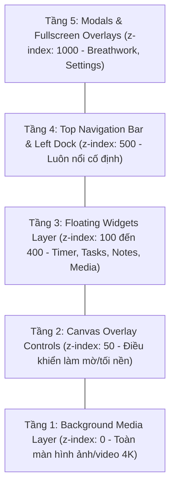
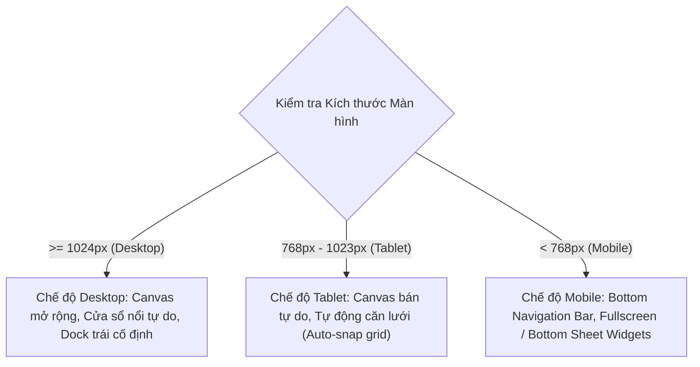

# 03 — ROUTES AND SCREENS (CẤU TRÚC ĐIỀU HƯỚNG VÀ MÀN HÌNH)

> **Mục tiêu:** Định nghĩa kiến trúc điều hướng URL, cấu trúc phân tầng giao diện (Layout Stacking Context), các màn hình widget chi tiết và giải pháp thích ứng đa thiết bị (Responsive Design).

---

## 1. Kiến trúc Điều hướng URL (SPA Routing Architecture)

Ứng dụng hoạt động theo mô hình **Single Page Application (SPA)** để đảm bảo âm thanh môi trường và đồng hồ đếm giờ không bị ngắt quãng khi người dùng chuyển đổi chế độ xem hoặc không gian `[INFERRED]`.

| URL Route | Tên màn hình / Trạng thái | Mục đích & Hành vi | Phân kỳ |
| :--- | :--- | :--- | :---: |
| `/` hoặc `/app` | **Workspace Canvas chính** | Màn hình làm việc chính, hiển thị background toàn cảnh cùng các widget đang mở `[OBSERVED]`. | P0 |
| `/app?space=:spaceId` | **Không gian được chỉ định** | Tải trực tiếp một không gian nền cụ thể theo mã định danh (ví dụ: `?space=cafe-tokyo` hoặc `?space=rain-cabin`) `[OBSERVED]`. | P0 |
| `/room/:roomId` | **Phòng học chung (Shared Room)** | Tham gia vào một phòng làm việc nhóm ảo theo mã phòng (chia sẻ nhịp timer) `[OBSERVED]`. | P2 |
| `/auth/callback` | **OAuth Callback Handler** | Điểm tiếp nhận phản hồi từ Google OAuth (Calendar hoặc Account sync) để lưu token `[INFERRED]`. | P1 |

---

## 2. Cấu trúc Phân tầng Giao diện (Layout Stacking Context & Z-Index)

Toàn bộ ứng dụng được tổ chức thành 5 tầng giao diện xếp chồng theo trục Z (CSS `z-index`):

1. **Tầng 1: Background Media Layer (`z-index: 0`) `[USER_REQUIREMENT]`:**
   - Chiếm `100vw` và `100vh`, cố định `position: fixed; inset: 0`.
   - Render thẻ `` (đối với ảnh tĩnh) hoặc `<video autoplay loop muted playsinline>` (đối với video nền).
   - Tích hợp lớp phủ gradient nhẹ để tăng độ tương phản cho các widget phía trên.
2. **Tầng 2: Canvas Overlay Controls (`z-index: 50`) `[USER_REQUIREMENT]`:**
   - Lớp phủ CSS backdrop-filter cho phép áp dụng hiệu ứng làm mờ nền (Blur) hoặc giảm độ sáng (Dim/Brightness) theo thanh trượt cài đặt của người dùng.
3. **Tầng 3: Floating Widgets Layer (`z-index: 100 - 400`) `[OBSERVED]`:**
   - Khu vực chứa các cửa sổ con: Pomodoro Timer, Tasks, Notes, Media, Calendar, Soundboard.
   - Khi người dùng click vào một widget, giá trị `z-index` của widget đó được đẩy lên cao nhất trong tầng này.
4. **Tầng 4: Chrome Controls (`z-index: 500`) `[OBSERVED]`:**
   - **Top Navigation Bar:** Nằm cố định ở viền trên cùng màn hình.
   - **Left Dock:** Nằm cố định ở viền trái màn hình.
5. **Tầng 5: Modal & Overlays (`z-index: 1000`) `[OBSERVED]`:**
   - Chứa màn hình bài tập thở Breathwork, hộp thoại Cài đặt hệ thống, hộp thoại Xác nhận hoặc popup phím tắt.

---

## 3. Đặc tả Chi tiết Các Màn hình & Khu vực Giao diện

### 3.1. Top Navigation Bar (Thanh Điều khiển Đỉnh)
- **Vị trí & Kích thước `[OBSERVED]`:** Cố định ở mép trên màn hình, chiều cao 56px, nền kính mờ `rgba(255, 255, 255, 0.75)` (hoặc đen mờ ở dark mode), hiệu ứng `backdrop-blur-md`.
- **Thành phần từ trái sang phải:**
  1. *Logo / Brand icon:* Biểu tượng ứng dụng tối giản.
  2. *Mode Selector Dropdown `[OBSERVED]`:* Menu xổ xuống chọn chế độ (`Focus` | `Plan` | `Explore`).
  3. *Streak Indicator `[OBSERVED]`:* Hiển thị số ngày học tập liên tục kèm biểu tượng ngọn lửa (`3 🔥`).
  4. *Quick Audio Mute Button `[USER_REQUIREMENT]`:* Nút tắt/bật nhanh toàn bộ âm thanh (Master Mute toggle).
  5. *Fullscreen Toggle Button `[OBSERVED]`:* Bật/tắt chế độ toàn màn hình F11 của trình duyệt.
  6. *Profile / Settings Dropdown `[OBSERVED]`:* Nút mở cài đặt âm thanh, giao diện, sao lưu dữ liệu.

### 3.2. Left Navigation Dock (Thanh Công cụ Bên Trái)
- **Vị trí & Kích thước `[OBSERVED]`:** Cố định ở mép trái, chiều rộng 72px, chiều cao toàn màn hình.
- **Danh sách Icon & Hành vi khi Click `[OBSERVED]`:**
  - `Spaces`: Bật/tắt bảng chọn hình nền và video không gian.
  - `Sounds`: Bật/tắt bảng Soundboard trộn âm thanh môi trường.
  - `Cal`: Bật/tắt widget Lịch và thời gian biểu.
  - `Timer`: Bật/tắt widget Pomodoro Timer (nếu đang bị ẩn).
  - `Tasks`: Bật/tắt widget Danh sách công việc.
  - `Notes`: Bật/tắt widget Ghi chú cá nhân.
  - `Media`: Bật/tắt widget Trình phát nhạc (YouTube / Spotify).
  - `Breath`: Kích hoạt mở modal bài tập thở thư giãn.
- **Trạng thái hiển thị nút:** Nút của widget đang mở trên màn hình sẽ có viền sáng hoặc nền màu thương hiệu (Active highlight).

---

## 4. Chi tiết Cấu trúc Từng Cửa sổ Widget (Floating Windows)

### 4.1. Widget Pomodoro Timer (`MOD-TIMER`)
- **Kích thước mặc định:** Rộng 360px, Cao tự động (Auto height).
- **Thành phần giao diện `[OBSERVED]`:**
  - *Header:* Tiêu đề chế độ (`Personal` kèm dropdown chọn `Task Countdown` / `Group`), 4 chấm tròn tiến trình chu kỳ Pomodoro, nút thu nhỏ `-`.
  - *Màn hình số chính:* Chữ số lớn hiển thị thời gian còn lại `MM:SS` (font Monospace sang trọng để số không bị nhảy bề ngang khi đếm).
  - *Nút chọn hiệp:* 3 nút tab chuyển nhanh `Pomodoro`, `Short Break`, `Long Break` có gạch chân màu cam đỏ dưới tab đang chọn.
  - *Nút hành động chính:* Nút `Start` (khi chạy đổi thành `Pause` với animation chuyển đổi), nút `Reset` xoay tròn 360 độ khi bấm.
  - *Nút Cài đặt (Bánh răng ⚙):* Mở rộng ngăn kéo cài đặt ngay trong widget (đổi số phút, chọn âm báo chuông, thanh trượt âm lượng chuông).

### 4.2. Widget Bảng Âm thanh Môi trường (`MOD-SOUNDS`)
- **Kích thước mặc định:** Rộng 380px, Cao tối đa 80vh (có thanh cuộn dọc ẩn mượt).
- **Thành phần giao diện `[OBSERVED]`:**
  - *Master Volume Slider:* Điều khiển công suất âm thanh toàn hệ thống (0% - 100%).
  - *Space Audio Slider:* Điều khiển âm thanh nền tự nhiên của video hiện tại.
  - *YouTube Custom Link Input:* Khung dán URL video/livestream YouTube kèm nút Play và slider volume riêng.
  - *Danh mục Ambiance:* Danh sách dạng lưới 2 cột hoặc danh sách cuộn dọc các âm thanh thiên nhiên/sóng não. Mỗi thẻ gồm: Biểu tượng icon sinh động, tên âm thanh, nút Mute nhanh, thanh trượt âm lượng riêng biệt.

### 4.3. Widget Quản lý Công việc (`MOD-TASKS`)
- **Kích thước mặc định:** Rộng 420px, Cao 500px (cho phép kéo dãn tự do bằng chuột qua resize handle góc dưới phải).
- **Thành phần giao diện `[OBSERVED]`:**
  - *Thanh lọc:* Dropdown `Tags`, Dropdown `Projects`, Dropdown `Filter` (Tất cả, Đang làm, Đã xong).
  - *Khung tạo việc nhanh:* Ô nhập văn bản kèm nút `+ Add task`, tự động nhận diện hashtag `#tag` và `@project`.
  - *Danh sách Task:*
    - Checkbox tròn hoặc vuông để tích hoàn thành (kèm hiệu ứng gạch ngang chữ mờ dần).
    - Tên công việc.
    - Nhãn dự án (Project badge) và nhãn thời gian ước tính (ví dụ: `2/4 🍅`).
    - Nút Play `(▷)`: Nhấn vào để gán ngay task này vào đồng hồ Pomodoro đang chạy.
  - *Footer:* Hiển thị tổng số việc `X/Y hoàn thành`, nút dọn dẹp việc đã xong.

### 4.4. Widget Ghi chú (`MOD-NOTES`)
- **Kích thước mặc định:** Rộng 400px, Cao 450px (cho phép resize).
- **Thành phần giao diện `[USER_REQUIREMENT]`:**
  - *Header:* Tiêu đề ghi chú có thể sửa trực tiếp, nút chọn gắn vào Task hiện tại hay ghi chú chung, nút sao chép (Copy Markdown).
  - *Khung soạn thảo:* Hỗ trợ gõ Markdown trực tiếp (Autosave sau 500ms), thanh công cụ định dạng nhanh (B, I, Checkbox, List, Code block).

### 4.5. Widget Trình phát Nhạc Media (`MOD-MEDIA`)
- **Kích thước mặc định:** Rộng 340px, Cao 220px.
- **Thành phần giao diện `[OBSERVED]`:**
  - Khung nhúng YouTube IFrame hoặc Spotify Preview Card.
  - Hiển thị ảnh bìa album, tên bài hát, nghệ sĩ biểu diễn.
  - Bộ nút điều khiển: Lùi bài (`⏮`), Phát/Tạm dừng (`▶`/`⏸`), Tiến bài (`⏭`), Lặp lại playlist.

---

## 5. Chiến lược Thích ứng Thiết bị (Responsive Layout Strategy)

### 5.1. Chế độ Màn hình Lớn (Desktop >= 1024px)
- Trải nghiệm nguyên bản như hệ điều hành máy tính để bàn: các widget có thể đặt ở bất kỳ tọa độ `(X, Y)` nào trên màn hình.
- Cho phép mở đồng thời nhiều widget (ví dụ: vừa mở Timer, vừa mở Tasks, vừa mở Soundboard).

### 5.2. Chế độ Máy tính Bảng (Tablet 768px - 1023px)
- Giữ nguyên thanh Dock bên trái.
- Các widget khi mở sẽ tự động căn theo lưới 2 cột (Snap to grid) để tránh chồng lấn lên nhau gây khó khăn cho thao tác cảm ứng chạm (Touch gestures).

### 5.3. Chế độ Điện thoại Di động (Mobile < 768px)
- **Tắt hoàn toàn cơ chế kéo thả tự do:** Màn hình di động không đủ diện tích để kéo thả cửa sổ.
- **Bottom Navigation Bar:** Di chuyển thanh Dock từ mép trái xuống mép dưới cùng màn hình (dễ dàng thao tác bằng ngón tay cái).
- **Giao diện Widget dạng Bottom Sheet:** Khi bấm vào icon trên thanh điều hướng, widget sẽ trượt lên từ đáy màn hình dưới dạng ngăn kéo (Drawer/Bottom Sheet) che 70% - 90% chiều cao màn hình, có thanh vuốt xuống (Swipe down to dismiss) để đóng nhanh.
- **Ưu tiên hiển thị:** Khi Pomodoro Timer đang chạy, hiển thị thanh đếm giờ rút gọn (Mini-timer banner) trên đỉnh màn hình để người dùng luôn theo dõi được thời gian ngay cả khi đang duyệt danh sách task.
