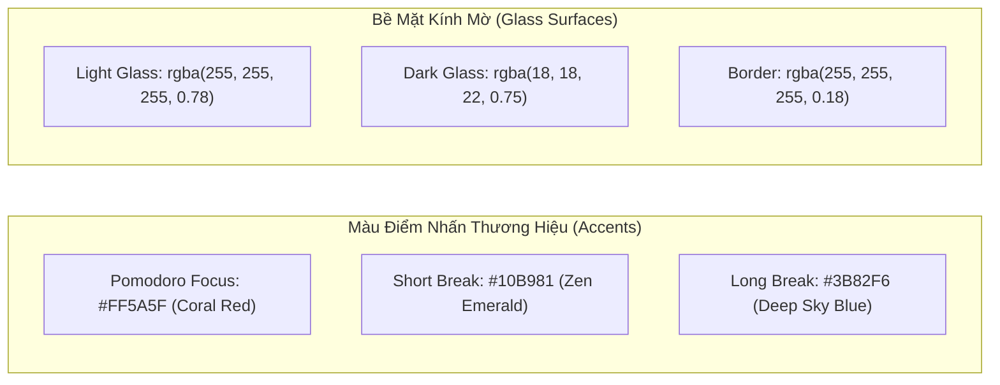

# 04 — DESIGN SYSTEM (HỆ THỐNG THIẾT KẾ VÀ GIAO DIỆN)

> **Mục tiêu:** Xây dựng quy chuẩn thẩm mỹ đồng bộ, ngôn ngữ thiết kế kính mờ đắm chìm (Immersive Glassmorphism), bảng màu chuẩn xác, hệ thống đo lường (Tokens), quy tắc kiểu chữ và âm thanh.

---

## 1. Triết lý Thiết kế (Design Philosophy)

1. **Ambient Glassmorphism (Kính mờ Tương thích Nền):**  
   Các thành phần giao diện không che khuất hoàn toàn phong cảnh phía sau mà đóng vai trò như các tấm kính hữu cơ mờ mịn (`backdrop-filter: blur(20px)` kết hợp độ mờ đục bán trong suốt 70% - 85%), hòa quyện tự nhiên vào mọi hình ảnh hoặc video nền `[OBSERVED]`.
2. **Zen Minimalism (Tối giản Tĩnh lặng):**  
   Giao diện triệt tiêu tối đa các chi tiết thừa thãi, viền sắc nhọn hoặc màu sắc gây chói mắt. Mọi chuyển động vi mô (Micro-interactions) đều mượt mà, tĩnh tại, giúp hệ thần kinh người dùng duy trì trạng thái thư thái và tập trung sâu `[USER_REQUIREMENT]`.
3. **Typography-First Clarity (Chữ số Rõ nét Tuyệt đối):**  
   Bộ đếm giờ là trung tâm thị giác; các con số được hiển thị bằng kiểu chữ đơn khoảng (Monospace Tabular Figures) để đảm bảo không bị rung lắc hay thay đổi bề ngang khi từng giây trôi qua `[INFERRED]`.

---

## 2. Bảng Màu Hệ Thống (Color Palette & Tokens)

Hệ thống hỗ trợ cơ chế tự động cân bằng tương phản dựa trên độ sáng của nền (hoặc người dùng có thể chủ động chuyển đổi giữa giao diện Kính Sáng - Glass Light và Kính Tối - Glass Dark).

### 2.1. Màu Điểm Nhấn Trạng thái Pomodoro (State Colors)
- **Focus / Pomodoro Active:**  
  `#FF5A5F` (Coral Red rực rỡ nhưng dịu mắt) — Kích thích ý chí tập trung và năng lượng hành động `[OBSERVED]`.
- **Short Break (Nghỉ ngắn):**  
  `#10B981` (Zen Emerald xanh lá tươi mát) — Mang lại cảm giác thư giãn, phục hồi thị lực `[USER_REQUIREMENT]`.
- **Long Break (Nghỉ dài):**  
  `#3B82F6` (Deep Sky Blue xanh dương tĩnh tại) — Báo hiệu thời gian nghỉ ngơi thư thái hoàn toàn `[USER_REQUIREMENT]`.

### 2.2. Bề Mặt Kính Mờ (Glass Surfaces)
- **Glass Panel Background (Light):** `rgba(255, 255, 255, 0.78)` kèm `backdrop-filter: blur(20px) saturate(180%)`.
- **Glass Panel Background (Dark):** `rgba(18, 18, 24, 0.75)` kèm `backdrop-filter: blur(24px) saturate(160%)`.
- **Border Stroke:** `1px solid rgba(255, 255, 255, 0.22)` (trên nền sáng) hoặc `1px solid rgba(255, 255, 255, 0.08)` (trên nền tối).
- **Shadow (Đổ bóng nổi):** `0 12px 32px -4px rgba(0, 0, 0, 0.15), 0 4px 12px -2px rgba(0, 0, 0, 0.08)`.

### 2.3. Màu Văn Bản & Biểu Tượng (Text & Foreground)
- **Text Primary (Chính):** `#0F172A` (Light mode) / `#F8FAFC` (Dark mode) — Độ tương phản tối thiểu 7:1.
- **Text Secondary (Phụ):** `#475569` (Light mode) / `#94A3B8` (Dark mode).
- **Text Muted (Vô hiệu/Nhạt):** `#94A3B8` (Light mode) / `#64748B` (Dark mode).

---

## 3. Quy chuẩn Kiểu Chữ (Typography Scale)

| Cấp bậc | Font Family | Kích cỡ | Trọng số (Weight) | Ứng dụng |
| :--- | :--- | :---: | :---: | :--- |
| **Timer Display** | `JetBrains Mono`, `Roboto Mono`, monospace | 56px / 64px | 700 (Bold) | Chữ số đếm lùi `MM:SS` chính giữa Pomodoro Timer `[USER_REQUIREMENT]`. |
| **Heading 1** | `Plus Jakarta Sans`, `Inter`, sans-serif | 22px | 700 (Bold) | Tiêu đề lớn của Widget, Tên Modal. |
| **Heading 2** | `Plus Jakarta Sans`, `Inter`, sans-serif | 16px | 600 (Semi-bold) | Tiêu đề khu vực (Master Volume, Ambiance, Task groups). |
| **Body Regular** | `Plus Jakarta Sans`, `Inter`, sans-serif | 14px | 400 (Regular) | Tên công việc, nội dung ghi chú, văn bản thông tin. |
| **Body Medium** | `Plus Jakarta Sans`, `Inter`, sans-serif | 14px | 500 (Medium) | Nhãn nút bấm, tab điều hướng. |
| **Caption / Tiny**| `Plus Jakarta Sans`, `Inter`, sans-serif | 12px | 400 / 500 | Nhãn phụ, thời gian deadline, phần trăm âm lượng. |

> [!TIP]
> Tất cả các font chữ đều ưu tiên phông hỗ trợ tiếng Việt chuẩn Unicode, không bị lỗi dấu thanh và được nạp thông qua Google Fonts hoặc tải cục bộ offline để bảo toàn ngân sách 0 đồng.

---

## 4. Hệ Thống Đo Lường (Spacing, Radius & Elevations)

### 4.1. Độ Bo Góc (Border Radius)
- `radius-sm`: `6px` — Dùng cho badge, nút bấm siêu nhỏ, thanh cuộn.
- `radius-md`: `10px` — Dùng cho khung nhập text (inputs), nút chọn (buttons), dropdown menus.
- `radius-lg`: `16px` — Dùng cho các thẻ con bên trong widget (Task items, Sound cards).
- `radius-xl`: `24px` — Dùng cho toàn bộ khung viền cửa sổ Widget và Modal `[OBSERVED]`.
- `radius-full`: `9999px` — Dùng cho nút tròn điều khiển Play/Pause, Avatar người dùng, chấm tiến trình.

### 4.2. Hệ Thống Khoảng Cách (Spacing 4px Base)
- `space-1`: `4px` | `space-2`: `8px` | `space-3`: `12px` | `space-4`: `16px`
- `space-6`: `24px` | `space-8`: `32px` | `space-12`: `48px`

---

## 5. Quy Chuẩn Biểu Tượng (Iconography)

- **Bộ Icon đề xuất:** Thư viện **Lucide Icons** (Mã nguồn mở, dung lượng siêu nhẹ, đường nét đồng nhất 2px stroke).
- **Quy tắc sử dụng:**
  - `Timer`: Biểu tượng đồng hồ đếm ngược `lucide:clock` hoặc `lucide:timer`.
  - `Sounds`: Biểu tượng sóng âm `lucide:volume-2` hoặc `lucide:sliders`.
  - `Tasks`: Biểu tượng danh sách `lucide:check-square`.
  - `Notes`: Biểu tượng trang giấy bút `lucide:file-text`.
  - `Spaces`: Biểu tượng quả cầu `lucide:globe` hoặc `lucide:image`.
  - `Media`: Biểu tượng phát nhạc `lucide:music` hoặc `lucide:play-circle`.
  - `Breath`: Biểu tượng vòng hoa thiền hoặc gió `lucide:wind`.

---

## 6. Thiết Kế Âm Thanh & Tần Số Tổng Hợp (Sound Tokens)

Thay vì nạp các tệp MP3 nặng nề dễ bị đứt kết nối, toàn bộ chuông báo Timer được thiết kế bằng **Web Audio API Synthesis Tokens** `[USER_REQUIREMENT]`:

| Mã chuông | Phong cách âm sắc | Công thức âm thanh (Web Audio API Parameters) |
| :--- | :--- | :--- |
| **Twinkle** `[OBSERVED]` | Chuông gió lấp lánh (Wind chime) | Chuỗi 3 nốt cao (E6: 1318Hz, G#6: 1661Hz, B6: 1975Hz), dạng sóng `sine`, decay 1.2s. |
| **Playtime** `[USER_REQUIREMENT]` | Gõ phím Marimba vui tươi | Hợp âm 3 nốt nhảy quãng (C5: 523Hz -> E5: 659Hz -> G5: 784Hz), dạng sóng `triangle`, attack nhanh. |
| **Sci-fi** `[USER_REQUIREMENT]` | Giai điệu không gian tương lai | Bộ dao động sóng `sawtooth` lọc qua `BiquadFilterNode` (lowpass sweep từ 400Hz lên 3000Hz). |
| **Slow Rise** `[USER_REQUIREMENT]` | Sóng ấm áp tăng dần | Tần số trượt từ 220Hz lên 440Hz kèm hiệu ứng tremolo (điều biên 4Hz), dịu dàng đánh thức tâm trí. |
| **Rooster** `[USER_REQUIREMENT]` | Tiếng gà gáy chiptune | Giả lập 8-bit retro vui nhộn mô phỏng giai điệu báo thức buổi sáng. |
| **Bird** `[USER_REQUIREMENT]` | Tiếng chim hót líu lo | Dao động sóng `sine` tần số cao (2400Hz - 3200Hz) với tốc độ điều tần nhanh (Frequency Modulation). |

---

## 7. Hiệu Ứng Chuyển Động & Động Lực Học (Animations & Motion)

- **Cửa sổ Mở / Thu nhỏ (Window Show/Hide):**  
  `cubic-bezier(0.16, 1, 0.3, 1)` (Spring easing tự nhiên), thời gian 240ms, phóng to từ 0.95 -> 1.0 và độ mờ từ 0 -> 1.
- **Kéo thả Cửa sổ (Dragging Feel):**  
  Khi đang kéo chuột, cửa sổ hơi nhấc lên một chút bằng cách tăng bóng đổ (`shadow-2xl`) và giảm nhẹ độ đục còn 90% để người dùng cảm nhận được chiều sâu vật lý.
- **Vòng tròn Hít thở Breathwork (`08-pro-space-modal.png`) `[OBSERVED]`:**  
  Chuyển động phóng to (Scale từ 1.0 lên 2.2) trong 4 giây nhịp nhàng, đứng yên 4 giây, thu nhỏ về 1.0 trong 4 giây và đứng yên 4 giây theo đúng chu kỳ hít thở khoa học.
