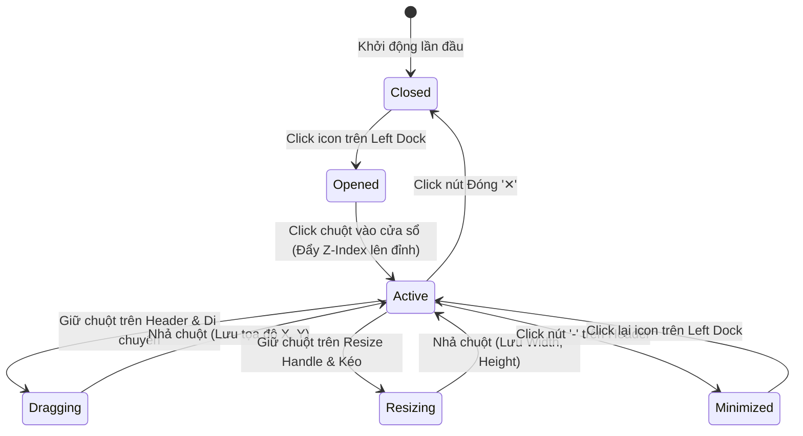
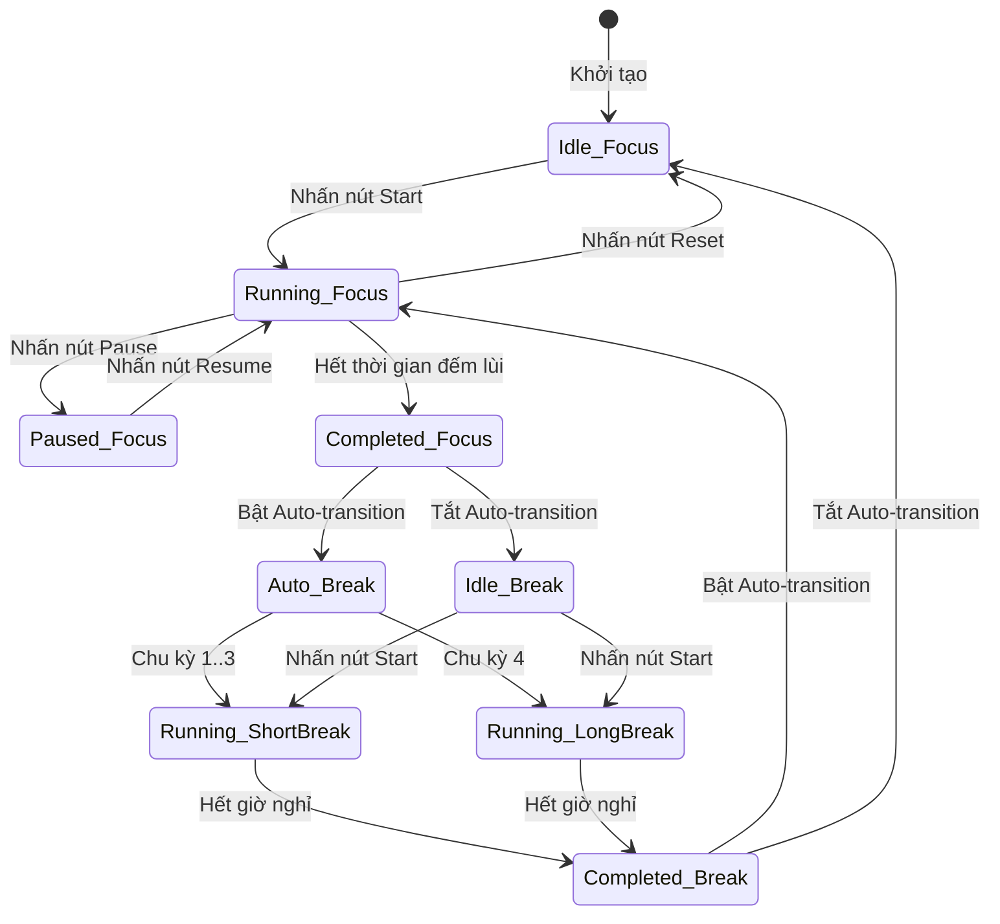
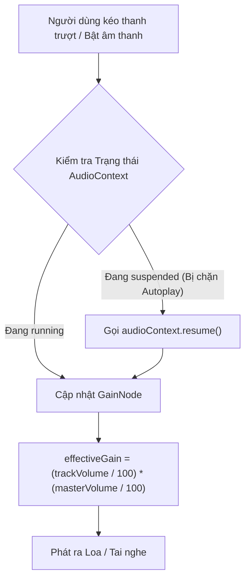

# 05 — INTERACTION SPECIFICATION (ĐẶC TẢ TƯƠNG TÁC NGƯỜI DÙNG)

> **Mục tiêu:** Định nghĩa chi tiết hành vi tương tác chuột, cảm ứng, bàn phím; máy trạng thái (State Machines); logic kéo thả cửa sổ; giải thuật âm thanh và các trường hợp biên (Edge Cases).

---

## 1. Trình Quản Lý Cửa Sổ Desktop (Window Manager Interactions)

Hệ thống cửa sổ mô phỏng trực giác của hệ điều hành máy tính để bàn (macOS / Windows), cho phép người dùng tự do bố trí không gian làm việc của mình `[USER_REQUIREMENT]`.

### 1.1. Thao tác Kéo thả Cửa sổ (Window Dragging)
- **Vùng kích hoạt (Drag Handle):** Toàn bộ thanh tiêu đề phía trên của widget (Header bar), ngoại trừ các nút bấm hành động (Close, Minimize, Settings) và các ô nhập liệu `[OBSERVED]`.
- **Sự kiện thực thi:** Sử dụng Pointer Events (`onPointerDown`, `onPointerMove`, `onPointerUp`) kết hợp `setPointerCapture` để đảm bảo khi chuột di chuyển cực nhanh ra ngoài mép cửa sổ vẫn không bị mất dấu `[INFERRED]`.
- **Ràng buộc Biên màn hình (Boundary Constraints) `[USER_REQUIREMENT]`:**
  - Cửa sổ không bao giờ được phép kéo vượt hoàn toàn ra ngoài màn hình khiến người dùng không lấy lại được.
  - *Quy tắc chặn biên:* Tọa độ `X` tối thiểu là `0`, tối đa là `window.innerWidth - widget.width`. Tọa độ `Y` tối thiểu là `topBarHeight (56px)`, tối đa là `window.innerHeight - 40px`.
- **Hiệu ứng thị giác khi kéo:** Cửa sổ tăng bóng đổ (`box-shadow`), con trỏ chuột chuyển sang dạng `cursor: grabbing`.

### 1.2. Thao tác Thay đổi Kích thước (Window Resizing)
- **Vùng kích hoạt (Resize Handle) `[OBSERVED]`:** Biểu tượng tam giác chấm ở góc dưới cùng bên phải của cửa sổ widget (kích thước vùng chạm 20x20px).
- **Ràng buộc kích thước (Min/Max Constraints):**
  - Widget Tasks: Tối thiểu `320px x 350px`, Tối đa `800px x 90vh`.
  - Widget Notes: Tối thiểu `300px x 300px`, Tối đa `1000px x 90vh`.
  - Widget Pomodoro Timer: Chiều rộng cố định `360px` để bảo toàn tỷ lệ chữ số, chiều cao tự động theo nội dung menu mở rộng.
- **Con trỏ chuột:** Chuyển sang dạng `cursor: nwse-resize`.

### 1.3. Cơ chế Xếp lớp Thứ tự Cửa sổ (Z-Index Stacking Order)
- Hệ thống duy trì một biến số toàn cục `highestZIndex` (bắt đầu từ `100`).
- Bất cứ khi nào người dùng click hoặc chạm vào bất kỳ điểm nào của một cửa sổ widget, `z-index` của widget đó sẽ được cập nhật bằng `++highestZIndex` `[INFERRED]`.
- Widget đang được thao tác sẽ luôn nổi lên trên cùng, đè lên các widget khác phía dưới.

### 1.4. Ghi nhớ Bố cục Không gian (Layout Persistence)
- Mọi thay đổi về vị trí `(x, y)`, kích thước `(width, height)`, trạng thái mở/đóng (`isOpen`, `isMinimized`) của từng widget được lưu tự động vào `LocalStorage` với cơ chế **Debounce 300ms** (để tránh ghi đĩa liên tục khi đang kéo dãn) `[USER_REQUIREMENT]`.
- Khi người dùng tải lại trang web hoặc mở tab mới, toàn bộ không gian làm việc được phục hồi đúng vị trí như phiên làm việc trước đó.

---

## 2. Máy Trạng Thái Pomodoro Timer (Timer State Machine)

Bộ đếm giờ hoạt động dựa trên máy trạng thái hữu hạn (Finite State Machine) nghiêm ngặt để đảm bảo không bao giờ xảy ra lỗi logic `[USER_REQUIREMENT]`.

### 2.1. Các Trạng thái Chi tiết
1. **Trạng thái `IDLE` (Chờ):** Đồng hồ hiển thị thời gian tròn trịa của hiệp (ví dụ `25:00` hoặc `40:00`), nút chính hiển thị `Start`.
2. **Trạng thái `RUNNING` (Đang đếm):**
   - Nút chính đổi thành `Pause`.
   - Tiêu đề tab trình duyệt cập nhật thời gian đếm lùi liên tục (`24:58 | Focus`).
   - Icon tròn hoặc thanh tiến trình chuyển động thu hẹp dần.
3. **Trạng thái `PAUSED` (Tạm dừng):** Thời gian đứng yên, nút chính hiển thị `Resume`, tiêu đề tab hiển thị `[Tạm dừng]`.
4. **Trạng thái `COMPLETED` (Hoàn thành hiệp):**
   - Đồng hồ chạm mốc `00:00`.
   - **Kích hoạt Chuông báo:** Phát chuông đã chọn (Twinkle, Sci-fi, Playtime...) qua Web Audio API ở âm lượng cài đặt.
   - **Gửi Thông báo Desktop:** Gửi Web Notification: *"Tuyệt vời! Bạn đã hoàn thành 1 hiệp tập trung. Hãy nghỉ ngơi chút nhé!"*.
   - **Cộng dồn thành tích:** Tự động tăng 1 điểm vào chuỗi streak và cộng dồn số Pomodoro đã hoàn thành cho Task đang gắn liền (nếu có).
   - **Chuyển hiệp:**
     - Nếu bật `Auto-transition`: Tự động kích hoạt hiệp nghỉ sau 1 giây báo chuông.
     - Nếu tắt `Auto-transition`: Chuyển sang trạng thái `IDLE` của hiệp nghỉ và chờ người dùng chủ động nhấn `Start`.

### 2.2. Quy tắc Tính Chu kỳ Nghỉ (Rounds Logic)
- Mỗi chu kỳ gồm 4 hiệp Pomodoro:
  - Hết Pomodoro 1 -> Nghỉ ngắn (Short Break - 5 phút).
  - Hết Pomodoro 2 -> Nghỉ ngắn (Short Break - 5 phút).
  - Hết Pomodoro 3 -> Nghỉ ngắn (Short Break - 5 phút).
  - Hết Pomodoro 4 -> **Nghỉ dài (Long Break - 15 hoặc 20 phút)**.
- Sau khi hết Long Break, bộ đếm chu kỳ đặt lại về 1 và bắt đầu vòng lặp mới.

---

## 3. Tương Tác Bảng Trộn Âm Thanh Môi Trường (Ambient Audio Mixer)

### 3.1. Cơ chế Vượt Rào cản Tự động Phát (Autoplay Policy Handling)
- Các trình duyệt hiện đại cấm phát âm thanh tự động nếu người dùng chưa tương tác với trang web.
- **Giải pháp:** Khi trang web tải lần đầu, `AudioContext` được tạo nhưng giữ ở trạng thái `suspended`.
- Ngay khi người dùng thực hiện cú click chuột đầu tiên lên bất kỳ nút nào (nút Play Timer, nút chọn âm thanh, thanh trượt volume), ứng dụng lập tức kích hoạt `audioContext.resume()` `[INFERRED]`.

### 3.2. Tính toán Âm lượng Đa kênh (Gain Calculation)
- Mỗi kênh âm thanh có một nút điều chỉnh độ khuếch đại riêng (`trackGainNode`).
- Toàn bộ các kênh sau đó kết nối chung vào một nút khuếch đại tổng (`masterGainNode`).
- Độ khuếch đại thực tế (Gain) được tính theo hàm phi tuyến tính (Logarithmic / Decibel Curve) thay vì tuyến tính để phù hợp với đặc tính cảm thụ âm thanh của tai người:
  $$\text{Gain}_{\text{effective}} = \left(\frac{\text{Volume}_{\text{track}}}{100}\right)^2 \times \left(\frac{\text{Volume}_{\text{master}}}{100}\right)^2$$

---

## 4. Tương Tác Quản Lý Công Việc & Liên Kết Pomodoro (Tasks Interaction)

1. **Thêm nhanh công việc (Quick Add):**
   - Nhập tên việc vào ô text và nhấn `Enter`. Task mới lập tức xuất hiện ở đầu danh sách mà không cần reload trang.
   - Hỗ trợ cú pháp tắt: gõ `#urgent` tự động gán tag, gõ `@study` tự động gán project.
2. **Đánh dấu Hoàn thành (Check Completion):**
   - Click vào ô checkbox: Task xuất hiện đường gạch ngang chữ, chuyển màu xám mờ và trượt xuống nhóm "Đã hoàn thành" sau 400ms kèm âm thanh click nhẹ nhàng.
3. **Gán Task vào Pomodoro Timer (Focus on Task) `[OBSERVED]`:**
   - Click vào nút `Play (▷)` bên cạnh task:
     - Tên của task được hiển thị ngay bên dưới đồng hồ đếm ngược Pomodoro.
     - Trạng thái của task chuyển sang nhãn `[Đang tập trung]`.
     - Khi đồng hồ Pomodoro kết thúc hiệp làm việc, trường `completedPomodoros` của task đó tự động tăng lên 1 (ví dụ: từ `1/3 🍅` thành `2/3 🍅`).

---

## 5. Bảng Phím Tắt Điều Khiển Nhanh (Keyboard Shortcuts)

Hỗ trợ phím tắt toàn cục giúp người dùng điều khiển không gian làm việc nhanh mà không cần dùng chuột `[USER_REQUIREMENT]`:

| Phím tắt | Tác vụ thực thi | Phạm vi hoạt động |
| :---: | :--- | :--- |
| `Space` | Bật / Tạm dừng Pomodoro Timer (`Start / Pause`) | Toàn cục (ngoại trừ khi đang gõ chữ trong ô input/notes) |
| `Alt + R` | Đặt lại hiệp hiện tại về thời gian ban đầu (`Reset Timer`) | Toàn cục |
| `Alt + M` | Tắt / Bật nhanh toàn bộ âm thanh (`Master Mute`) | Toàn cục |
| `Alt + T` | Bật / Ẩn widget Quản lý Công việc (`Toggle Tasks`) | Toàn cục |
| `Alt + S` | Bật / Ẩn bảng trộn Âm thanh (`Toggle Soundboard`) | Toàn cục |
| `Alt + B` | Mở bài tập thở thư giãn (`Open Breathwork`) | Toàn cục |
| `F11` | Bật / Tắt chế độ toàn màn hình không viền | Toàn cục |
| `Esc` | Đóng menu đang mở hoặc đóng Modal toàn màn hình | Khi đang có Modal active |

---

## 6. Xử Lý Các Tình Huống Biên & Lỗi Ngoại Lệ (Edge Cases Handling)

1. **Người dùng mở ứng dụng trên nhiều Tab cùng lúc:**
   - Sử dụng `BroadcastChannel` của trình duyệt để đồng bộ hóa trạng thái đếm giờ giữa các tab. Nếu tab 1 nhấn Start Timer, tab 2 sẽ tự động đồng bộ theo, tránh tình trạng 2 tab phát chuông lệch giờ nhau gây ồn `[INFERRED]`.
2. **Người dùng tải tệp hình nền tùy chỉnh quá nặng (> 20MB):**
   - Hệ thống hiển thị cảnh báo: *"Hình nền dung lượng lớn có thể làm chậm trình duyệt"*, tự động nén kích thước hoặc gợi ý dùng link ảnh ngoài để không làm tràn bộ nhớ trình duyệt `[USER_REQUIREMENT]`.
3. **Mất kết nối Internet khi đang làm việc (Offline mode):**
   - Ứng dụng vẫn hoạt động 100% bình thường với dữ liệu cục bộ (IndexedDB), các âm chuông tổng hợp và âm thanh đã tải vào bộ nhớ đệm (Cache Storage).
   - Chỉ tạm thời vô hiệu hóa luồng phát YouTube và đồng bộ lịch Google cho đến khi có mạng trở lại.
