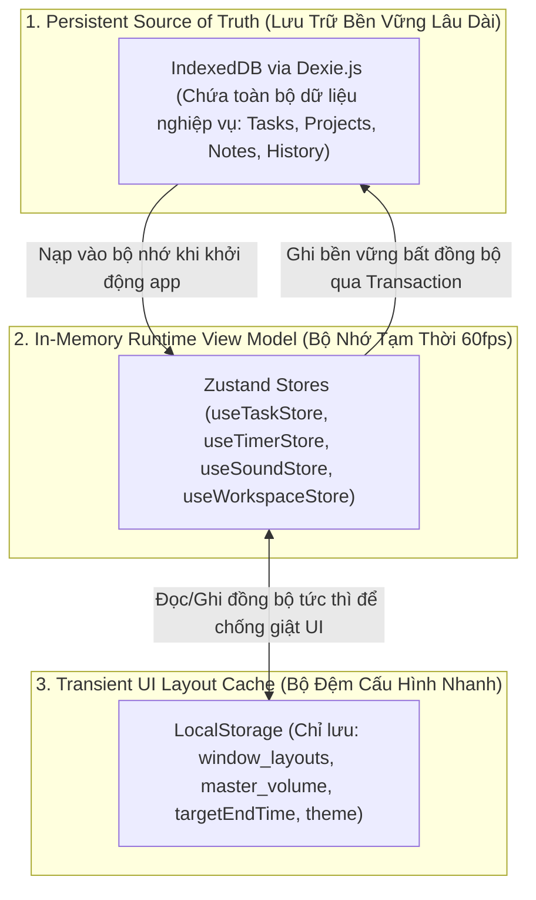

# 07 — DATA MODEL (MÔ HÌNH DỮ LIỆU & BẢO TOÀN DỮ LIỆU)

> **Mục tiêu:** Định nghĩa chi tiết ranh giới Nguồn Chân Lý Duy Nhất (Single Source of Truth), lược đồ thực thể TypeScript, kiến trúc lưu trữ đa tầng (IndexedDB, Zustand, LocalStorage), cơ chế chống ghi trùng dữ liệu (Idempotency) và chính sách xử lý lỗi/sao lưu.

---

## 1. Ranh Giới Nguồn Chân Lý (Single Source of Truth - SSOT)

Để ngăn chặn tuyệt đối lỗi mâu thuẫn trạng thái (State Desynchronization) và mất mát dữ liệu, hệ thống phân chia nghiêm ngặt vai trò của 3 tầng lưu trữ:



| Tầng lưu trữ | Công nghệ | Dữ liệu quản lý | Nguyên tắc truy cập |
| :--- | :--- | :--- | :--- |
| **Persistent SSOT** | `IndexedDB` (Dexie.js) | `tasks`, `projects`, `tags`, `notes`, `focus_sessions` | Là nguồn chân lý cao nhất. Mọi thao tác tạo/sửa/xóa đều phải ghi nhận thành công tại đây. |
| **In-Memory Cache** | `Zustand` | Bản sao dữ liệu đang hiển thị, trạng thái đếm giờ từng tick, AudioContext node references | Không chứa logic lưu trữ vĩnh viễn; phục vụ render React siêu tốc. |
| **Transient UI Cache** | `LocalStorage` | Tọa độ x,y,w,h cửa sổ widget, volume tổng, `targetEndTime` của timer, theme | Dữ liệu có thể mất hoặc xóa mà không làm mất nội dung công việc của người dùng. |

---

## 2. Định Nghĩa Thực Thể TypeScript (TypeScript Entities & Schemas)

### 2.1. Thực thể Phiên Tập Trung & Lịch Sử (Focus Session - Chống ghi trùng)

```typescript
export type SessionMode = 'personal' | 'group' | 'task_countdown';
export type SessionPhase = 'pomodoro' | 'short_break' | 'long_break';

export interface FocusSessionRecord {
  id: string;               // UUID v4 - Khóa chống ghi trùng (Idempotency Key)
  taskId?: string | null;   // ID của task liên kết (nếu có)
  taskTitle?: string | null;// Lưu lại tên task tại thời điểm học
  mode: SessionMode;
  phase: SessionPhase;
  durationMinutes: number;  // Thời lượng thực tế (VD: 25)
  completedAt: number;      // Epoch UTC timestamp (milliseconds)
  dateString: string;       // YYYY-MM-DD theo múi giờ máy khách
}
```

### 2.2. Thực thể Công Việc, Dự Án & Thẻ (Tasks, Projects, Tags)

```typescript
export type TaskPriority = 'p1' | 'p2' | 'p3';
export type TaskStatus = 'todo' | 'in_progress' | 'completed' | 'archived';
export type TaskRepeat = 'none' | 'daily' | 'weekly';

export interface Project {
  id: string;               // UUID v4
  name: string;
  colorHex: string;
  createdAt: number;
}

export interface Tag {
  id: string;               // UUID v4
  name: string;
  colorHex: string;
}

export interface Task {
  id: string;               // UUID v4
  title: string;
  description?: string;
  projectId?: string | null;
  tagIds: string[];
  priority: TaskPriority;
  status: TaskStatus;
  estimatedPomodoros: number; // Dự kiến số hiệp (VD: 4)
  completedPomodoros: number; // Số hiệp đã hoàn thành thực tế (VD: 2)
  deadline?: number | null;   // Timestamp hạn chót
  repeat: TaskRepeat;
  orderIndex: number;         // Thứ tự hiển thị
  createdAt: number;
  updatedAt: number;
  completedAt?: number | null;
}
```

### 2.3. Thực thể Ghi Chú (Notes)

```typescript
export interface Note {
  id: string;               // UUID v4
  title: string;
  contentMarkdown: string;
  linkedTaskId?: string | null;    // Khóa ngoại lỏng lẻo tới Task
  linkedProjectId?: string | null; // Khóa ngoại lỏng lẻo tới Project
  createdAt: number;
  updatedAt: number;
}
```

### 2.4. Thực thể Cấu Hình & Trạng Thái Cửa Sổ (Window Layouts & Timer)

```typescript
export interface WidgetLayout {
  id: string;               // 'timer' | 'tasks' | 'notes' | 'sounds' | 'spaces'
  x: number;                // Tọa độ X (pixel, >= 0)
  y: number;                // Tọa độ Y (pixel, >= 56)
  width: number;            // Chiều rộng
  height: number;           // Chiều cao
  isOpen: boolean;
  isMinimized: boolean;
  zIndex: number;
}

export interface PersistedTimerState {
  sessionId: string;        // UUID của phiên hiện tại
  status: 'idle' | 'running' | 'paused' | 'completed';
  phase: 'pomodoro' | 'short_break' | 'long_break';
  currentRound: number;
  durationMinutes: number;
  targetEndTimeMs: number | null;
  pausedRemainingMs: number | null;
  linkedTaskId: string | null;
}
```

---

## 3. Lược Đồ IndexedDB & Cơ Chế Nâng Cấp Schema (Database Migrations)

Khởi tạo cơ sở dữ liệu với **Dexie.js**:

```typescript
import Dexie, { Table } from 'dexie';

export class PomodoroDatabase extends Dexie {
  tasks!: Table<Task, string>;
  projects!: Table<Project, string>;
  tags!: Table<Tag, string>;
  notes!: Table<Note, string>;
  focus_sessions!: Table<FocusSessionRecord, string>;

  constructor() {
    super('ImmersivePomodoroDB');

    // Phiên bản 1: Định nghĩa cấu trúc bảng và chỉ mục tìm kiếm
    this.version(1).stores({
      tasks: '&id, status, projectId, *tagIds, deadline, orderIndex, updatedAt',
      projects: '&id, name, createdAt',
      tags: '&id, name',
      notes: '&id, linkedTaskId, linkedProjectId, updatedAt',
      focus_sessions: '&id, dateString, taskId, completedAt'
    });
  }
}

export const db = new PomodoroDatabase();
```

---

## 4. Chính Sách Xóa & Toàn Vẹn Quan Hệ (Deletion & Cascade Semantics)

1. **Quy tắc Xóa Task (Soft-Delete trước, Hard-Delete sau):**
   - Khi người dùng click nút xóa trên task, task được chuyển trạng thái `status = 'archived'` (Soft Delete).
   - Chỉ khi người dùng bấm "Dọn sạch thùng rác / Xóa vĩnh viễn" thì mới gọi `db.tasks.delete(taskId)`.
2. **Quy tắc Bảo toàn Ghi chú (No Orphan Cascade Loss):**
   - Khi một Task bị xóa vĩnh viễn, mọi ghi chú liên kết (`linkedTaskId === taskId`) **tuyệt đối không bị xóa theo**.
   - Hệ thống tự động thực thi transaction cập nhật: `note.linkedTaskId = null` để chuyển ghi chú thành dạng "Ghi chú độc lập", đảm bảo người dùng không bao giờ mất thông tin ghi chép quan trọng.
3. **Quy tắc Bảo toàn Lịch sử Học tập:**
   - Các bản ghi trong `focus_sessions` luôn giữ lại `taskTitle` tại thời điểm hoàn thành hiệp, dù task gốc sau này có bị sửa tên hoặc xóa bỏ.

---

## 5. Cơ Chế Sao Lưu & Khôi Phục Dự Phòng (JSON Backup & Export Schema)

Để phòng ngừa trường hợp người dùng vô tình xóa lịch sử duyệt web hoặc xóa cache trình duyệt, hệ thống cung cấp tính năng Xuất/Nhập dữ liệu dự phòng:

```typescript
export interface BackupDataPayload {
  exportVersion: 1;
  appVersion: "1.0.0";
  exportedAt: number;        // UTC epoch ms
  checksum: string;          // Chuỗi hash SHA-256 xác thực tính toàn vẹn
  data: {
    tasks: Task[];
    projects: Project[];
    tags: Tag[];
    notes: Note[];
    focus_sessions: FocusSessionRecord[];
    userPreferences: Record<string, unknown>;
  };
}
```

- **Quy trình Nhập file (Import Flow):**
  1. Đọc tệp `.json` do người dùng tải lên.
  2. Kiểm tra tính hợp lệ qua thư viện xác thực Schema (Zod / Type Guards).
  3. Mở một `Dexie.transaction('rw', [db.tasks, db.projects, db.tags, db.notes, db.focus_sessions])`.
  4. Ghi đè hoặc hợp nhất dữ liệu an toàn. Nếu xảy ra lỗi giữa chừng, toàn bộ transaction tự động rollback về trạng thái trước khi nhập.
