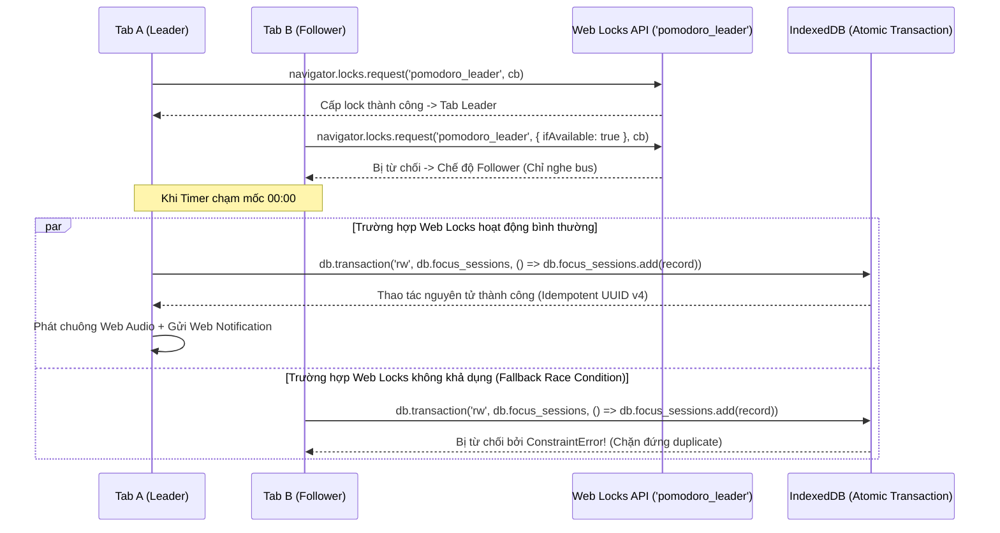
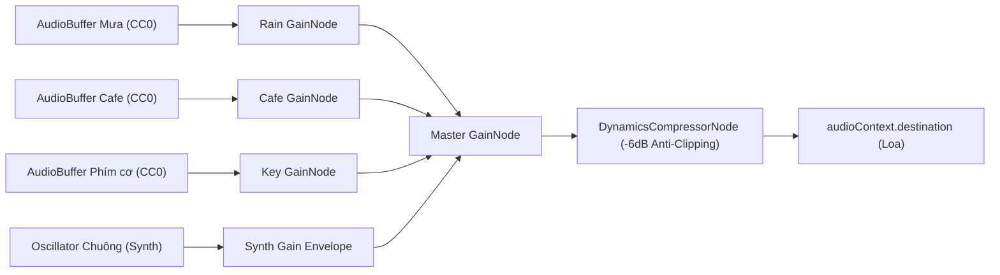

# 08 — TECHNICAL ARCHITECTURE (KIẾN TRÚC KỸ THUẬT CƯỜNG HÓA V4)

> **Mục tiêu:** Định nghĩa kiến trúc kỹ thuật chuẩn mực, giải quyết triệt để rủi ro xung đột đa tab qua Web Locks API và IndexedDB Atomic Transactions, xử lý đồng hồ hệ thống và máy ngủ theo giới hạn thực tế, phân bổ bộ nhớ đệm Workbox dưới hạn mức 2 MiB, tích hợp Playwright E2E và cam kết vận hành 0 đồng.

---

## 1. Ma Trận Dependency Cố Định & Trạng Thái Xác Minh

Toàn bộ gói phụ thuộc được ghim phiên bản chính xác, không dùng ký tự dải tự do `^`:

| Gói phụ thuộc | Phiên bản cố định | Trạng thái xác minh |
| :--- | :--- | :--- |
| `react` & `react-dom` | `18.3.1` | Kiểm tra tĩnh: Bản phát hành ổn định chuẩn React 18. |
| `vite` | `5.4.14` | Kiểm tra tĩnh: Bản vá ổn định nhất của Vite 5. |
| `@vitejs/plugin-react` | `4.3.4` | Kiểm tra tĩnh: Plugin Fast Refresh chính thức cho Vite 5. |
| `typescript` | `5.6.3` | Kiểm tra tĩnh: Trình biên dịch tĩnh an toàn. |
| `tailwindcss` | `3.4.17` | Kiểm tra tĩnh: Bản ổn định chuẩn (loại bỏ chữ "LTS" không chính thức). |
| `postcss` & `autoprefixer` | `8.4.49` / `10.4.20` | Kiểm tra tĩnh: Xử lý CSS tương thích đa trình duyệt. |
| `vite-plugin-pwa` | `0.20.5` | Kiểm tra tĩnh: Nhánh hỗ trợ Vite 5 và Workbox 7. |
| `workbox-window` | `7.3.0` | Kiểm tra tĩnh: Đăng ký Service Worker từ client. |
| `zustand` | `4.5.5` | Kiểm tra tĩnh: Quản lý state in-memory nhẹ. |
| `dexie` | `4.0.11` | Kiểm tra tĩnh: ACID wrapper cho IndexedDB. |
| `lucide-react` | `0.468.0` | Kiểm tra tĩnh: Bộ icon SVG tối giản. |
| `vitest` | `2.1.8` | Kiểm tra tĩnh: Unit test runner. |
| `@testing-library/react` | `16.1.0` | Kiểm tra tĩnh: Component test helper. |
| `@playwright/test` | `1.49.1` | Kiểm tra tĩnh: E2E browser testing. |

> [!NOTE]
> *Lưu ý về tính tương thích:* Ma trận trên là kết quả kiểm tra tĩnh tài liệu. Mức độ tương thích toàn diện của toàn bộ dependency graph sẽ được xác nhận thực tế thông qua việc tạo lockfile, cài đặt thành công và chạy build/test ở giai đoạn scaffold.

---

## 2. Kiến Trúc Điều Phối Timer Đa Tab & Xử Lý Đồng Hồ Hệ Thống

### 2.1. Cơ Chế Bầu Tab Leader Qua Web Locks API & Fallback An Toàn
- Tab đầu tiên mở ra sẽ yêu cầu giữ lock: `navigator.locks.request('pomodoro_timer_leader', async (lock) => { ... })`.
- Tab Leader chịu trách nhiệm duy nhất: phát nhịp đếm, kiểm tra deadline, kích hoạt chuông và thực thi ghi nhận lịch sử vào IndexedDB.
- Các Tab phụ (Followers) khi không lấy được lock sẽ lắng nghe `BroadcastChannel` để cập nhật hiển thị đồng hồ theo Tab Leader, tuyệt đối không tự ý phát chuông hoặc ghi dữ liệu.
- **Khi Web Locks API không khả dụng:** Hệ thống sử dụng heartbeat key trên `localStorage` làm gợi ý hoạt động (activity hint). Cơ chế an toàn tối hậu chống ghi trùng lịch sử **hoàn toàn dựa vào IndexedDB Atomic Transaction** với Primary Key constraint (`ConstraintError`), không dựa vào `localStorage` như một distributed lock.

### 2.2. Xử Lý Giới Hạn Máy Ngủ & Can Thiệp Đồng Hồ Hệ Thống
- `targetEndTime` (Wall-clock `Date.now()`) là mốc thời gian bền vững duy nhất được lưu vào `localStorage`.
- Trong phiên đang chạy liên tục trong tab, hệ thống kết hợp `performance.now()` để đo các khoảng thời gian trôi qua, giúp phát hiện khi đồng hồ hệ thống bị người dùng hoặc NTP điều chỉnh đột ngột (> 2000ms).
- **Thừa nhận giới hạn kỹ thuật:** Khi máy tính rơi vào trạng thái ngủ sâu (OS Sleep/Suspend) hoặc reload trang, `performance.now()` bị reset hoặc tiến triển khác nhau tùy thuộc vào hệ điều hành và trình duyệt. Hệ thống áp dụng chính sách khôi phục dựa trên so sánh `Date.now()` với `targetEndTime` và chấp nhận rằng việc tái dựng thời gian ngủ phụ thuộc vào thông tin mà nền tảng cung cấp khi máy tỉnh giấc.

---

## 3. Kiến Trúc Âm Thanh Web Audio API & Quản Lý Tài Nguyên

- **DynamicsCompressorNode:** Đặt ngay sau `MasterGainNode` với các thông số:
  - `threshold`: `-6.0 dB`, `knee`: `12 dB`, `ratio`: `8`, `attack`: `0.003 s`, `release`: `0.25 s`.  
  *Tác dụng:* Nén dải động, bảo vệ loa và tai nghe của người dùng không bị rè hoặc méo tiếng khi bật đồng thời 3 track âm thanh ở mức volume 100%.
- **Bắt Lỗi Autoplay & Khôi Phục:**
  - Không tuyên bố "không bao giờ lỗi `DOMException`".
  - Sử dụng khối `try/catch` toàn diện khi gọi `audioContext.resume()`. Nếu trình duyệt từ chối hoặc thiết bị âm thanh bận, ứng dụng hiển thị thông báo nhẹ trên thanh Top Bar: *"Click để bật âm thanh"* và cho phép người dùng kích hoạt lại.
- **Giải Phóng Bộ Nhớ (Memory Cleanup):**
  - Khi tắt âm thanh hoặc đóng widget, gọi phương thức `stop()` trên `AudioBufferSourceNode` và ngắt kết nối `disconnect()` để trình gom rác (Garbage Collector) thu hồi RAM ngay lập tức.

---

## 4. Chiến Lược Cache Workbox Dưới Hạn Mức 2 MiB & Xử Lý Video Nền

1. **Precache App Shell (< 2 MiB):**
   - Workbox mặc định giới hạn file precache ở mức **2 MiB** (`maximumFileSizeToCacheInBytes: 2097152`).
   - Cấu trúc Precache bắt buộc chỉ gồm: `index.html`, bundle JS chia nhỏ (< 300KB), CSS (< 50KB), font chữ offline, và **3 hình nền tĩnh WebP tuyển chọn (< 300KB mỗi ảnh)**.
   - Tổng dung lượng Precache xấp xỉ **1.5 MiB**, nằm an toàn trong giới hạn của Workbox.
2. **Xử Lý Video Nền (Progressive Enhancement):**
   - Video nền WebM (< 4MB) **không đưa vào Precache App Shell** ban đầu để tránh làm chậm lần nạp đầu tiên và tránh vượt hạn mức Workbox.
   - Video được nạp qua cơ chế **Runtime Cache** (`CacheFirst` với dung lượng tối đa 20 MiB).
   - **Cơ chế Fallback Ngoại tuyến:** Nếu người dùng đang ngoại tuyến hoàn toàn mà video nền chưa kịp tải vào CacheStorage, hệ thống tự động hiển thị hình nền tĩnh WebP tương ứng đã precache sẵn, kèm thông báo: *"Đang hiển thị hình ảnh tĩnh ở chế độ ngoại tuyến"*.

---

## 5. Ranh Giới Lưu Trữ Dữ Liệu (Data SSOT Hierarchy)

| Tầng lưu trữ | Công nghệ | Dữ liệu quản lý | Nguyên tắc truy cập |
| :--- | :--- | :--- | :--- |
| **Persistent SSOT** | `IndexedDB` (Dexie.js) | `tasks`, `projects`, `tags`, `notes`, `focus_sessions` | Là nguồn chân lý duy nhất. Ghi nhận giao dịch ACID. |
| **In-Memory Cache** | `Zustand` | Bản sao dữ liệu đang hiển thị, trạng thái đếm giờ từng tick, Web Audio nodes | Phục vụ render React 60fps; không chứa logic lưu trữ vĩnh viễn. |
| **Transient UI Cache** | `LocalStorage` | Khóa `pomodoro_runtime` (`targetEndTimeMs`, `sessionId`, `phase`), `window_layouts`, `theme`, `volume` | Bộ đệm cấu hình giao diện nhanh; có thể xóa mà không mất dữ liệu công việc. |
