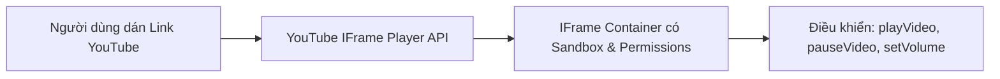
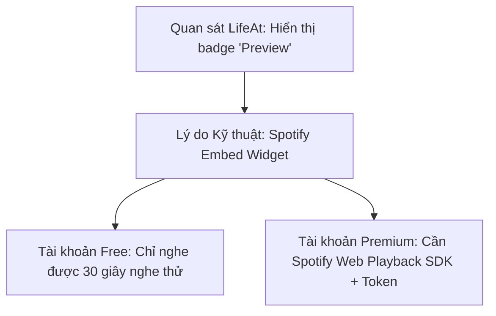

# 09 — INTEGRATION CONSTRAINTS (RÀO CẢN VÀ GIỚI HẠN TÍCH HỢP BÊN THỨ BA)

> **Mục tiêu:** Phân tích thực tế, thẳng thắn và chi tiết về các giới hạn pháp lý, kỹ thuật, API, chính sách bản quyền và chi phí khi tích hợp các dịch vụ bên thứ ba (YouTube, Spotify, Apple Music, Google Calendar, WebRTC). Không hứa hẹn các tính năng không khả thi.

---

## 1. Bảng Đánh Giá Khả Thi Các Dịch Vụ Tích Hợp (Feasibility Summary)

| Nền tảng tích hợp | Mức độ khả thi | Yêu cầu tài khoản | Khả năng phát ngầm | Chi phí API | Khuyến nghị cho dự án |
| :--- | :---: | :---: | :---: | :---: | :--- |
| **YouTube IFrame API** | **Rất cao (P0)** | Không cần | Tốt trên Desktop, hạn chế trên Mobile | **0 VNĐ** | **Giải pháp nhạc chính cho MVP** |
| **Spotify IFrame Embed** | **Trung bình (P1)** | Miễn phí (Bản 30s) / Premium (Cả bài) | Hạn chế | **0 VNĐ** | Chỉ nhúng thẻ Preview hoặc mở App |
| **Apple MusicKit JS** | **Rất thấp (P2)** | Cần Apple Music + Thẻ Dev $99 | Hạn chế | **Tốn phí** | **Loại bỏ khỏi MVP** |
| **Google Calendar OAuth** | **Cao (P1)** | Tài khoản Google miễn phí | Không áp dụng | **0 VNĐ** | Tích hợp đọc lịch qua OAuth PKCE |
| **WebRTC Voice Chat** | **Trung bình (P2)** | Không cần | Tốt | **Tiềm ẩn phí TURN** | Đưa vào giai đoạn P2 đánh giá thêm |

---

## 2. Phân Tích Kỹ Thuật Chi Tiết Từng Nền Tảng

### 2.1. YouTube & YouTube Music Integration (`MOD-MEDIA`)

- **Khả năng thực tế `[USER_REQUIREMENT]`:**
  - Cho phép người dùng dán URL video đơn lẻ, URL danh sách phát (Playlist), hoặc các luồng phát trực tiếp (Livestream lofi 24/7).
  - Điều khiển được các lệnh cơ bản thông qua YouTube IFrame Player API: `player.playVideo()`, `player.pauseVideo()`, `player.setVolume(vol)`, `player.mute()`, `player.unMute()`.
- **Các giới hạn và rào cản bắt buộc phải chấp nhận `[INFERRED]`:**
  1. *Quảng cáo của Google (Advertisements):* Không thể tắt hoặc can thiệp vào quảng cáo bằng code. Quảng cáo sẽ phát theo chính sách của Google đối với kênh đó.
  2. *Chính sách phát ngầm trên thiết bị di động (Mobile Background Playback):* Khi người dùng khóa màn hình điện thoại hoặc chuyển sang ứng dụng khác trên iOS Safari / Android Chrome, trình duyệt sẽ tự động ép dừng phát video YouTube trong IFrame để bảo vệ bản quyền. Trên Desktop thì phát nền bình thường.
  3. *Quyền nhúng (Embedding Restrictions):* Một số video âm nhạc thuộc các hãng đĩa lớn bị chủ sở hữu tắt tính năng "Cho phép nhúng trên trang web khác" (Error code 150/101). Hệ thống cần hiển thị thông báo thân thiện: *"Video này bị chủ kênh giới hạn nhúng, vui lòng chọn video khác"*.
  4. *Yêu cầu thuộc tính IFrame:* Bắt buộc cấu hình `allow="autoplay; encrypted-media; picture-in-picture"` để player hoạt động ổn định.

---

### 2.2. Spotify Integration (Quan sát từ LifeAt `01-home-app.png`)

- **Bằng chứng từ LifeAt `[OBSERVED]`:**
  - Trên ảnh `evidence/01-home-app.png`, widget Media của LifeAt có hiển thị rõ huy hiệu tím **`Preview`**.
  - Điều này chứng minh ngay cả nền tảng lớn như LifeAt cũng chỉ có thể cung cấp đoạn nghe thử 30 giây (30-second preview audio clip) đối với người dùng phổ thông khi nhúng qua Spotify Embed API.
- **Giải pháp cho dự án của chúng ta `[USER_REQUIREMENT]`:**
  - Không hứa hẹn phát trọn vẹn toàn bộ bài hát Spotify miễn phí (vì Spotify kiểm soát bản quyền nhạc rất chặt chẽ).
  - Cho phép hiển thị thẻ bài hát Spotify đẹp mắt (Ảnh bìa album, tên nghệ sĩ, preview 30s) và cung cấp nút bấm "Mở trên Spotify" (`Open in Spotify`) để người dùng nghe toàn bài trên ứng dụng Spotify chính thức của họ.

---

### 2.3. Google Calendar API & OAuth 2.0 Integration (`MOD-CAL`)

- **Kiến trúc xác thực 0 đồng (Client-Side OAuth 2.0 with PKCE) `[INFERRED]`:**
  - Không cần xây dựng backend xác thực; sử dụng trực tiếp thư viện **Google Identity Services (GIS)** của Google trên trình duyệt.
  - Người dùng bấm nút "Kết nối Google Calendar" -> Cửa sổ popup của Google hiện lên yêu cầu đồng ý.
  - Sau khi cấp quyền, ứng dụng nhận được `access_token` và lưu vào `sessionStorage` để gọi API Google Calendar.
- **Phạm vi quyền tối thiểu (Least Privilege Scope) `[USER_REQUIREMENT]`:**
  - Chỉ yêu cầu quyền đọc: `https://www.googleapis.com/auth/calendar.events.readonly`.
  - Tuyệt đối không yêu cầu quyền chỉnh sửa hoặc xóa lịch của người dùng ở giai đoạn đầu để tạo sự an tâm tuyệt đối về quyền riêng tư.
- **Xử lý Hết hạn Token (Token Expiration & Quotas):**
  - Access Token của Google có thời hạn sống 3600 giây (1 giờ).
  - Khi token hết hạn, ứng dụng sẽ thực hiện gọi chế độ gia hạn ngầm (Silent Token Refresh via `tokenClient.requestAccessToken({ prompt: '' })`) mà không làm phiền người dùng phải đăng nhập lại.
  - Hạn mức miễn phí (Quotas): Google cấp miễn phí 1.000.000 lượt yêu cầu/ngày cho mỗi project Google Cloud Console, hoàn toàn đáp ứng nhu cầu sử dụng cá nhân và cộng đồng mà không tốn một đồng chi phí.

---

### 2.4. Công Nghệ WebRTC & Phòng Học Chung (Shared Rooms & Voice Chat)

- **Nguyên lý hoạt động và Thách thức NAT Traversal `[INFERRED]`:**
  - Để 2 người dùng có thể đàm thoại trực tiếp (Voice Chat) qua WebRTC, họ cần kết nối ngang hàng (Peer-to-Peer).
  - Tuy nhiên, trong thực tế có từ 15% - 20% người dùng sử dụng mạng 4G hoặc mạng Wi-Fi công ty có tường lửa nghiêm ngặt (Symmetric NAT), khiến kết nối ngang hàng trực tiếp thất bại.
  - Khi đó, bắt buộc phải có máy chủ trung gian chuyển tiếp âm thanh (TURN Server).
- **Rủi ro chi phí phát sinh (Cost Risks) `[INFERRED]`:**
  - Băng thông âm thanh chất lượng tốt tốn khoảng 30 - 50 kbps mỗi luồng. Với một phòng học 10 người cùng bật mic trong 4 tiếng, lưu lượng dữ liệu chuyển tiếp qua TURN có thể tiêu tốn hàng chục Gigabyte băng thông mỗi ngày.
  - Các nhà cung cấp TURN server thương mại (như Twilio) sẽ tính phí theo từng Gigabyte truyền qua.
- **Quyết định cho dự án `[USER_REQUIREMENT]`:**
  - **MVP (Giai đoạn P0):** Tuyệt đối không đưa Voice Chat vào để giữ cam kết chi phí 0 đồng và độ ổn định cao.
  - **Giai đoạn P2:** Sẽ thử nghiệm kết nối nhóm thông qua các dịch vụ Realtime miễn phí (như Supabase Broadcast hoặc LiveKit Cloud gói miễn phí) để chia sẻ nhịp đếm Pomodoro chung giữa các thành viên, trước khi cân nhắc kích hoạt micro đàm thoại.

---

## 3. Chính Sách Tự Động Phát Âm Thanh Trên Trình Duyệt (Browser Autoplay Policies)

Mọi trình duyệt hiện đại (Chrome, Edge, Safari, Firefox) đều áp dụng chính sách **Muted Autoplay Only** để bảo vệ trải nghiệm người dùng:
1. Video hoặc âm thanh có tiếng chỉ được phép tự động phát nếu đã có một hành động tương tác vật lý (User Gesture: Click, Tap, Keypress) diễn ra trên tài liệu HTML trước đó.
2. Nếu trang web cố tình gọi `audio.play()` hoặc tạo âm thanh ngay khi vừa mở URL, trình duyệt sẽ chặn đứng và ném lỗi `DOMException: play() failed because the user didn't interact with the document first`.
3. **Giải pháp bắt buộc cho ứng dụng:**
   - Mặc định khởi động: Video nền chạy ở chế độ `muted`.
   - Hiển thị biểu tượng âm thanh nhấp nháy nhẹ hoặc nút "Bật không gian" thân thiện.
   - Khi người dùng click bất kỳ điểm nào, `AudioContext` sẽ chuyển sang trạng thái `running` và bật âm thanh mượt mà (Fade in 1.5s).
