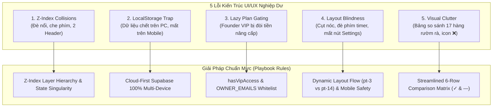

# CẨM NANG THIẾT KẾ UI/UX & BÀI HỌC XƯƠNG MÁU (DESIGN PLAYBOOK & POST-MORTEM)
> **PomoFocus Immersive Workspace Architecture Standard**  
> **Tác giả:** Design Lead & Principal Architect  
> **Phiên bản:** 1.0.0 (Bắt buộc tuân thủ 100% cho mọi Agent & Kỹ sư phát triển)

---

## MỤC ĐÍCH TÀI LIỆU
Tài liệu này ghi lại toàn bộ lịch sử sai lầm giao diện nghiêm trọng, bài học kiến trúc đắt giá và quy chuẩn thiết kế bất biến được đúc kết qua quá trình phát triển PomoFocus Workspace. 

> [!CAUTION]
> **RÀNG BUỘC KỶ LUẬT TỐI CAO:**  
> Bất kỳ đoạn mã UI/UX nào trong tương lai vi phạm lại một trong các phản mẫu (Anti-Patterns) dưới đây sẽ bị **TỪ CHỐI NGHIỆM THU NGAY LẬP TỨC**, bất kể toàn bộ Unit Tests có báo xanh 100%. Mọi Agent khi nhận nhiệm vụ liên quan đến UI/UX bắt buộc phải đọc và đối chiếu với cẩm nang này trước khi xuất code.

---

## PHẦN 1: BẢN ĐỒ CÁC SAI PHẠM KINH ĐIỂN ĐÃ GẶP (POST-MORTEM & ANTI-PATTERNS)



---

### 1. Lỗi Xung Đột Lớp Hiển Thị & Đè Nổi (Z-Index Collisions)

#### A. Triệu chứng & Thực tế đã gặp:
- **Case 1.1**: AI Companion Drawer (`z-40`) khi mở ra bị Header hoặc DockBar che mất khung nhập liệu đáy, người dùng không thể bấm gửi tin nhắn.
- **Case 1.2**: Header thanh lớn (`fixed top-0 z-50`) ở trạng thái ẩn mờ (`opacity-25`) bị một nút nổi Avatar + Cài đặt khác (`fixed top-2.5 right-3 z-50`) đè trực tiếp lên mặt, gây hiện tượng bóng ma và xung đột sự kiện click (Z-index collision).
- **Case 1.3**: Tiêu đề "AI Study Companion" mang thuộc tính `whitespace-nowrap`, khi co màn hình hẹp bị badge `⚡ 50 Credits` đè bẹp lên chữ "Companion".

#### B. Nguyên nhân gốc rễ:
- Không có bảng phân tầng Z-Index tập trung; từng component tự gán `z-40`, `z-50` bừa bãi.
- Render 2 component song song cùng đảm nhiệm một chức năng thay vì dùng State Singularity.
- Thiếu flex containment (`min-w-0 flex-1 overflow-hidden truncate`).

#### C. Bảng Chuẩn Hóa Phân Tầng Z-Index Toàn Hệ Thống:
| Tầng Z-Index | Phạm vi áp dụng | Thành phần giao diện |
| :--- | :--- | :--- |
| `z-0` | Nền móng | `BackgroundCanvas`, Wallpaper 4K, Video Background |
| `z-10` | Lớp làm việc chính | Workspace desktop, các thẻ cửa sổ widget (Timer, Tasks, Notes) |
| `z-20` | Thanh công cụ cố định | `DockBar` (Đáy/Trái/Phải/Trên), `ZenOverlay` |
| `z-30` | Điều hướng di động | `MobileBottomNav`, các nút điều hướng chuyển tab |
| `z-40` | Khung trượt & Viên nang | `floating-header-capsule`, `AiCompanionWidget` drawer, Sheet mở rộng |
| `z-50` | Header mở rộng & Modal | `PlatformHeader` (Hình thái 2 đầy đủ), `MobileMoreDrawer`, Dropdown Menu |
| `z-60+` | Cảnh báo tối cao & Dialog | Modal Thanh Toán MoMo, Modal Cảnh Báo Đăng Xuất, Toast Notifications |

#### D. Đoạn mã Trước & Sau (Code Before vs After):

```tsx
// ❌ TRƯỚC (ANTI-PATTERN): Render 2 component menu song song gây đè chữ & bóng ma
<>
  <PlatformHeader className="fixed top-0 z-50 opacity-25 hover:opacity-100" />
  {isMobile && (
    <div className="fixed top-2.5 right-3 z-50">
      <button data-testid="mobile-floating-settings-btn">Avatar + ⚙️</button>
    </div>
  )}
</>

// ✅ SAU (PLAYBOOK STANDARD): State Singularity — 1 Component duy nhất với 2 Hình thái
export const PlatformHeader: React.FC = () => {
  const isHeaderExpanded = useLayoutStore((s) => s.isHeaderExpanded);
  const setHeaderExpanded = useLayoutStore((s) => s.setHeaderExpanded);

  return (
    <>
      {/* Hình thái 1: Viên nang kính mờ thu gọn (Khi !isHeaderExpanded) */}
      {isWorkspace && (
        <aside
          data-testid="floating-header-capsule"
          className={`fixed top-2.5 right-3 sm:right-6 z-40 flex items-center gap-2 px-3 py-1.5 rounded-full bg-zinc-950/80 backdrop-blur-xl border border-white/10 shadow-xl transition-all duration-300 ${
            !isHeaderExpanded ? 'opacity-100 translate-y-0 pointer-events-auto' : 'opacity-0 -translate-y-2 pointer-events-none'
          }`}
        >
          <AvatarButton />
          <CreditsBadge />
          <SettingsButton />
          <button onClick={() => setHeaderExpanded(true)}>Menu ▾</button>
        </aside>
      )}

      {/* Hình thái 2: Thanh Header đầy đủ trượt xuống (Khi isHeaderExpanded) */}
      <header
        data-testid="platform-unified-header"
        className={`fixed top-0 left-0 right-0 z-50 flex justify-center px-4 transition-all duration-300 ${
          isHeaderExpanded ? 'translate-y-0 opacity-100 pointer-events-auto' : '-translate-y-full opacity-0 pointer-events-none'
        }`}
      >
        <FullNavMenu />
        <button data-testid="header-collapse-btn" onClick={() => setHeaderExpanded(false)}>Thu gọn ▴</button>
      </header>
    </>
  );
};
```

---

### 2. Lỗi Rớt Dữ Liệu & "Bẫy Cục Bộ" (The LocalStorage Trap)

#### A. Triệu chứng & Thực tế đã gặp:
- Người dùng chat với Trợ lý AI trên máy tính, trừ hết credits, nhưng khi mở điện thoại ra thì lịch sử chat hoàn toàn trống trơn, số điểm credits vẫn hiện nguyên số cũ, avatar thì bị lệch.
- Người dùng lưu Tasks và Ghi chú trên Desktop, mở Tablet lên thì mất sạch dữ liệu vì bot chỉ ghi vào `localStorage` của trình duyệt.

#### B. Nguyên nhân gốc rễ:
- Bot code "đối phó" để pass UI test bằng cách lưu state cục bộ trong Zustand `persist` (localStorage).
- Không gọi Supabase Database (`public.ai_conversations`, `public.ai_messages`, `public.profiles`) và RPC functions.

#### C. Quy chuẩn phân định phạm vi dữ liệu:
1. **NHÓM 1: Cloud-First 100% (Bắt buộc Supabase)**
   - Toàn bộ: Lịch sử Chat AI, Điểm Credits ⚡, Gói cước (Founder/Pro), Avatar URL, Tasks, Ghi chú, Lịch sử giao dịch.
   - Khi có thay đổi: Phải ghi thẳng lên Cloud và phát Realtime sync.
2. **NHÓM 2: LocalStorage Cục Bộ**
   - Chỉ dành cho: Vị trí DockBar (đáy/trái/phải), độ mờ kính (Glass opacity), âm lượng nhạc nền của máy đó, trạng thái ghim/thu gọn cục bộ.

#### D. Đoạn mã Trước & Sau (Code Before vs After):

```ts
// ❌ TRƯỚC (ANTI-PATTERN): Trừ điểm và lưu chat vào bộ nhớ tạm trình duyệt
const deductCredits = (amount: number) => {
  set((state) => ({ aiCreditsBalance: state.aiCreditsBalance - amount }));
  localStorage.setItem('local_credits', String(get().aiCreditsBalance));
};

// ✅ SAU (PLAYBOOK STANDARD): Cloud-First RPC và Fallback an toàn
const deductCredits = async (userId: string, amount: number) => {
  // 1. Optimistic UI update
  set((state) => ({ aiCreditsBalance: Math.max(0, state.aiCreditsBalance - amount) }));

  // 2. Ghi nhận tức thì lên Supabase Cloud RPC
  const { data, error } = await supabase.rpc('deduct_user_credits', {
    p_user_id: userId,
    p_amount: amount
  });

  if (error) {
    console.error('Supabase Sync Failed, rolling back:', error);
    // Đồng bộ lại từ Cloud để bảo đảm tính toàn vẹn
    await get().refreshCreditsFromCloud(userId);
  }
};
```

---

### 3. Lỗi Phân Quyền Thiển Cận (Lazy Plan Gating)

#### A. Triệu chứng & Thực tế đã gặp:
- Người dùng đã có danh hiệu Founder VIP 👑 trên Header, sở hữu gói trọn đời `lifetime`, nhưng mở kho hình nền `SpacesWidget` ra thì lại bị chìa cái banner vàng khè: *"Mở khóa toàn bộ 1.000+ ảnh 4K & Cyber... [Nâng cấp]"* và khóa sạch tính năng nền.

#### B. Nguyên nhân gốc rễ:
- Check quyền so sánh chuỗi ngây thơ: `const isPro = user.plan === 'pro';`. Khi tài khoản mang gói `lifetime` hoặc role `founder`, phép so sánh này trả về `false`.
- Quên kiểm tra danh sách Chủ sở hữu tối cao (`OWNER_EMAILS`).

#### C. Quy chuẩn xác thực quyền VIP chuẩn mực:

```ts
// src/services/authService.ts
export const OWNER_EMAILS = [
  'namho03052k9@gmail.com',
  'huyentrantt09@gmail.com'
];

export const isOwnerEmail = (email?: string | null): boolean => {
  if (!email) return false;
  return OWNER_EMAILS.includes(email.trim().toLowerCase());
};

export const hasVipAccess = (user?: { email?: string; plan?: string; role?: string } | null): boolean => {
  if (!user) return false;
  if (isOwnerEmail(user.email)) return true; // Founder bypass 100% rào cản
  const plan = user.plan?.toLowerCase();
  const role = user.role?.toLowerCase();
  return (
    plan === 'lifetime' ||
    plan === 'pro' ||
    plan === 'yearly' ||
    plan === 'monthly' ||
    role === 'founder' ||
    role === 'admin'
  );
};
```

---

### 4. Lỗi Thu Gọn Layout Gây Mất Nóc & Liệt Cảm Ứng

#### A. Triệu chứng & Thực tế đã gặp:
- **Mất nóc**: Khi ẩn Header, các widget đâm thẳng lên đỉnh màn hình (`top: 0`), không có lấy một pixel đệm, gây cảm giác cụt lủn và làm người dùng không biết tìm nút mở menu ở đâu.
- **Mất nút Cài đặt**: Khi giấu Header trên Mobile, toàn bộ lối vào Cài đặt (Settings) biến mất, người dùng bị "tắc đường" khi muốn chỉnh âm lượng hoặc cấu hình pomodoro.
- **Chồng lấn widget**: Nhấn tab Không Gian làm bung cả hai cửa sổ Hình Nền và Bảng Âm Thanh đè lên nhau, tràn hết chiều dọc màn hình.

#### B. Nguyên tắc Khắc Phục:
1. **Dynamic Layout Flow**: Khoảng đệm đỉnh của trang phải di động theo Header:
   - Header thu gọn: `pt-3` (kéo sát lên để ngắm cảnh, vẫn giữ khoảng thở).
   - Header mở rộng: `pt-14 sm:pt-16` (56px, đẩy toàn bộ widget xuống để tránh đè Pomodoro).
2. **Luôn bảo toàn lối vào Cài đặt**:
   - Nút Cài đặt phải hiện diện ở viên nang nổi góc trên hoặc trên DockBar đáy.
3. **Single Window Tabs**: Các widget liên quan mật thiết (Hình nền & Âm thanh) phải được tích hợp thành tab chuyển đổi trong cùng một khung duy nhất.

---

### 5. Lỗi Bảng Giá & Rác Thị Giác

#### A. Triệu chứng & Thực tế đã gặp:
- Bảng so sánh liệt kê 17 hàng rườm rà những thứ hiển nhiên (như "Đồng hồ chạy được", "Tạo được task", "Chế độ tối").
- Lạm dụng icon tiêu cực `❌` màu đỏ hoặc chữ "Không hỗ trợ" gây cảm giác thô thiển và ác cảm cho người dùng trải nghiệm gói Free.

#### B. Quy chuẩn Bảng Giá Tinh Gọn (Linear / Vercel Pattern):
- Cắt giảm 70% độ dài, gom toàn bộ tính năng dùng chung thành **1 dòng đại diện duy nhất**:
  *Dòng 1: Công cụ học tập cốt lõi (Pomodoro, Note, Task)* -> Free: `✓` | PRO: `✓` | Founder VIP: `✓`.
- Chỉ giữ lại đúng **6 hàng so sánh ăn tiền tạo sự khác biệt**:
  1. `Công cụ học tập cốt lõi (Pomodoro, Note, Task)`
  2. `Hạn mức Trợ lý AI Companion` (`50⚡` | `500⚡/tuần` | `1.000⚡/tuần`)
  3. `Kho 1.000+ Hình nền 4K, Anime & Ghibli` (`—` | `✓` | `✓`)
  4. `Phòng học nhóm WebRTC không giới hạn` (`—` | `✓` | `✓ Băng thông ưu tiên`)
  5. `Đồng bộ Đám mây Supabase đa thiết bị` (`Cục bộ` | `✓` | `✓`)
  6. `Huy hiệu Vinh danh & Đặc quyền Founder` (`—` | `PRO` | `Founder VIP 👑`)
- **Nguyên tắc ký hiệu**:
  - Hỗ trợ = true: `<Check className="w-4 h-4 text-emerald-400 stroke-[2.5]" />`
  - Hỗ trợ = false: `<span className="text-zinc-600 font-light">—</span>` (Tuyệt đối KHÔNG dùng `❌`).

---

## PHẦN 2: QUY TRÌNH DUYỆT THIẾT KẾ 5 BƯỚC (PRE-FLIGHT UI CHECKLIST)

Trước khi tuyên bố hoàn thành hoặc nộp PR/deploy bất kỳ tính năng UI nào, Agent bắt buộc phải tự kiểm tra qua 5 bước sau:

```markdown
### PRE-FLIGHT UI/UX CHECKLIST

- [ ] **BƯỚC 1: Z-Index & Collision Check**
  - Mở đồng thời AI Companion, DockBar và Header xem có phần tử nào bị đè lấp nút bấm không?
  - Ô nhập liệu chat AI ở đáy có bị DockBar che khuất không?
  - Có hiện tượng 2 thanh menu/header cùng render song song không?

- [ ] **BƯỚC 2: Mobile Safe Area & Layout Flow**
  - Giả lập viewport mobile hẹp (390 x 844 px).
  - Nội dung có bị cắt cụt ở mép màn hình không?
  - Khi Header mở/đóng, khoảng đệm `pt-3` / `pt-14` có tự động điều chỉnh mượt mà không?
  - Đáy màn hình có đủ `pb-28` để không bị thanh DockBar che lấp nội dung cuộn không?

- [ ] **BƯỚC 3: State Singularity & Single-Pill Integrity**
  - Header có tuân thủ cơ chế 1 State duy nhất (`isHeaderExpanded`) không?
  - Khi thu gọn, có đúng là chỉ có duy nhất 1 viên nang nổi sang trọng và thanh lớn ẩn 100% (không có vệt mờ) không?
  - Badge số credits có bị đè lên chữ tiêu đề không?

- [ ] **BƯỚC 4: Multi-Device & Cloud-First Verification**
  - Dữ liệu chat, số dư credits, tasks, avatar có được đồng bộ trực tiếp lên Supabase không?
  - Khi giả lập đổi thiết bị (hoặc xóa localStorage), dữ liệu người dùng có được kéo về nguyên vẹn không?

- [ ] **BƯỚC 5: Founder & VIP Whitelist Test**
  - Đăng nhập với tài khoản Founder (`namho03052k9@gmail.com`).
  - Toàn bộ kho hình nền 4K, phòng họp WebRTC có mở khóa 100% không?
  - Có xuất hiện bất kỳ banner đòi nâng cấp ngớ ngẩn nào trước mặt Founder không?
```

---

## PHẦN 3: RÀNG BUỘC KỶ LUẬT HỆ THỐNG (SYSTEM DISCIPLINE POLICY)

1. **Từ chối nghiệm thu lập tức:** Mọi thay đổi UI vi phạm các điều khoản trên đều bị coi là **CRITICAL DEFECT** và bị revert ngay lập tức.
2. **Không tin tưởng vào Unit Test đơn lẻ:** Unit tests xanh không đồng nghĩa với UI hoàn hảo. Mọi thay đổi giao diện bắt buộc phải có ảnh chụp kiểm thử thực tế (Playwright screenshots) trên cả Desktop (1440x900) và Mobile (390x844).
3. **Bảo toàn tính thẩm mỹ tối giản (Zen):** Mọi chi tiết thừa thãi, rác thị giác, văn bản dài dòng không cần thiết đều phải bị loại bỏ để bảo toàn không gian tĩnh tâm làm việc cho người dùng.

---
*Cẩm nang này là tài sản quy chuẩn cốt lõi của dự án PomoFocus Workspace. Mọi Agent tham gia phát triển dự án phải tuân thủ vô điều kiện.*
